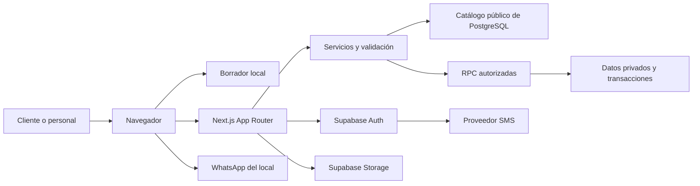

# 01. Arquitectura de la aplicación

**Actualización del 10/10/2026:** el acceso del cliente es por enlace privado/QR, sin SMS; nombre y teléfono son datos declarados. [Diseño vigente](16-acceso-a-tarjeta-sin-sms.md) sustituye las menciones anteriores a OTP, identidad telefónica Auth y `phone_change` del cliente. MFA del personal se conserva.

**Versión:** 1.1 · **Fecha:** 3 de octubre de 2026.  
**Relacionado:** [Índice y decisiones](README.md), [Datos](03-modelo-de-datos.md), [Contratos](05-contratos-y-operaciones.md).

## 1. Punto de partida y objetivo

El repositorio contiene Next.js 16.3.8, React 19.2.8, TypeScript estricto y Tailwind 4, con `src/app`. No hay integración de Supabase, catálogo implementado, migraciones ni pruebas de negocio. Se mantiene este stack y se añade lo necesario por etapas.

La aplicación tiene dos circuitos independientes: preparar pedidos como invitado y gestionar fidelización con identidad verificada. Next.js coordina interfaces y operaciones; Supabase aporta Auth, PostgreSQL, Data API y Storage. No existe un servicio que observe automáticamente la conversación de WhatsApp.

## 2. Diagrama de componentes



Las conexiones a Data API usan HTTPS. El navegador puede conocer la URL y la clave publicable de Supabase; eso no le concede permisos privados. Toda autorización efectiva queda también en la base de datos.

## 3. Responsabilidades por capa

| Capa | Responsabilidad | Límite |
| --- | --- | --- |
| Componentes de servidor | Carta inicial, datos públicos, páginas privadas y DTO mínimos. | No entregan objetos completos de Auth ni filas internas al cliente. |
| Componentes de cliente | Cantidades, formularios, modal, borrador, copia y enlace de WhatsApp. | Sus precios, roles y contadores no son autoridad. |
| Server Actions | Mutaciones de perfil, acceso, mantenimiento, sellos y canjes. | Autenticación y autorización en cada llamada; no basta ocultar botones. |
| Route Handlers | Lecturas JSON y validación pública del borrador. | Respuestas limitadas, sin guardar pedidos ni registrar sus cuerpos. |
| Servicios de dominio | Validadores Zod, DTO y reglas de catálogo, importes y mensaje. | No duplican contadores de fidelización que pertenecen a SQL. |
| PostgreSQL/RPC | Integridad, permisos, historial, bloqueo e idempotencia. | No conoce la entrega física: depende de la validación del empleado autorizado. |
| Supabase Auth | Identidad, OTP, sesión y MFA. | Una identidad existente no convierte a alguien en personal. |
| Storage | Fotografías públicas oficiales del catálogo. | No almacena comprobantes, OTP ni fotos de clientes en el MVP. |

## 4. Módulos y organización propuesta

La organización se implementará dentro de `src`, conservando alias `@/*`:

```text
src/
  app/                 rutas, layouts, actions y handlers
  components/          controles compartidos y feedback accesible
  features/
    catalog/           carta, opciones y mantenimiento
    cart/              reducer, persistencia y revisión
    checkout/          datos mínimos y mensaje
    loyalty/           tarjeta, atención y DTO
    auth/              acceso y sesión
  lib/
    supabase/          clientes public, browser, server y proxy
    server/            DAL, autorización y funciones server-only
    validation/        esquemas compartidos de entrada
    money/             céntimos y presentación PEN
  types/               tipos generados de BD y contratos de dominio
supabase/              futuras migraciones, seed y pruebas SQL
```

No se instala ni crea esta estructura durante la documentación. Los módulos `server-only` impiden importaciones accidentales desde componentes de cliente. Las utilidades de dinero y borrador son puras y no dependen del SDK.

## 5. Acceso a Supabase

Se distinguen cuatro clientes:

1. **Público sin sesión:** clave publicable, sin cookies; ejecuta `read_catalog()` para obtener la proyección publicable. No tiene lectura directa de tablas comerciales.
2. **Servidor por petición:** `@supabase/ssr`, cookies de esa petición y JWT del usuario; RPC bajo su identidad.
3. **Navegador:** `@supabase/ssr` para los casos de Auth/MFA que requieran SDK. Ninguna clave privilegiada.
4. **Administración de Auth:** cliente aislado `server-only`, clave secreta, únicamente altas/invitaciones/bajas autorizadas de cuentas. No se usa para acreditar sellos ni leer todas las tarjetas.

El cliente autenticado no es un singleton global: una petición nunca hereda la sesión de otra. Proxy se limita a renovar sesiones en rutas privadas y endpoints asociados; cada servicio valida identidad otra vez. El catálogo público no lee cookies ni renueva sesiones.

La proyección pública es una frontera de publicación: excluye precios fuente, información sin verificar y campos operativos internos. Las RPC privadas proyectan identidad y permisos del caller. Los componentes de servidor llaman directamente a la DAL; no hacen HTTP a los Route Handlers de la propia aplicación. Los handlers existen para consumidores del navegador y comparten la misma DAL.

## 6. Flujos principales

**Pedido:** SSR de catálogo → selección local → checkout local → `POST /api/cart/validate` → resolución explícita de cambios → mensaje construido con importes validados → enlace `wa.me` → envío manual y coordinación externa. No hay estado `order_confirmed`, webhook ni persistencia de solicitud.

**Cliente:** OTP real → sesión → activación opcional del perfil con condiciones aceptadas → RPC de tarjeta propia → edición de indicaciones. El teléfono de Auth, ya verificado, es fuente de identidad; el cuerpo de una petición no puede elegir el propietario.

**Personal:** acceso con MFA → búsqueda exacta de teléfono → ficha mínima → confirma compra pagada y entrega → RPC transaccional de sello → resultado real. El canje tiene su operación y no implica compra.

**Responsable:** acceso con MFA → cambia precio/disponibilidad con revisión de versión → RPC con auditoría → vuelve a consultar catálogo. No se proporciona un editor de SQL ni una gestión comercial completa.

## 7. Rendimiento, caché y fallos

Para el tamaño inicial de la carta se prioriza consistencia: sin caché compartida de catálogo o datos privados en el MVP. Consultas al SDK llevan `fetch` con `cache: 'no-store'`; lecturas privadas y validación responden `Cache-Control: no-store`. Se mantiene `cacheComponents` deshabilitado y no se mezclan APIs de caché de modelos distintos.

Las fotografías usan nombres versionados y caché de assets; dimensiones reservadas, formatos WebP/AVIF y carga diferida salvo imagen principal. Si luego la carga exige cachear catálogo, será un cambio documentado con caducidad e invalidación, conservando validación fresca antes de WhatsApp.

| Fallo | Respuesta |
| --- | --- |
| Auth o programa de sellos caído | La compra como invitado sigue disponible si el catálogo puede validarse. |
| Base de catálogo caída | Conservar borrador y vista ya cargada; bloquear preparación de una solicitud con precios que no pudieron validarse y mostrar contacto directo del local. |
| Storage caído | Fallback de fotografía, nombre y precio legibles. |
| Resultado incierto de mutación | Consultar estado con el mismo `operationId`; no generar una operación nueva. |
| WhatsApp no disponible | Mostrar mensaje, copia y reapertura sin perder el pedido. |

## 8. Dependencias y fuentes técnicas

Añadir en implementación: SDK Supabase, SSR, Zod, Vitest/Testing Library, Playwright y herramientas de pruebas SQL. No se añade Zustand: reducer y contexto cubren el carrito. No se añade ORM: las migraciones SQL y tipos generados son la referencia del esquema.

Se consultaron las guías **instaladas** bajo `node_modules/next/dist/docs/01-app/`: `01-getting-started/05-server-and-client-components.md`, `07-mutating-data.md`, `08-caching.md`, `02-guides/data-security.md`, `02-guides/authentication.md`, `02-guides/caching-without-cache-components.md` y `03-api-reference/05-config/01-next-config-js/serverActions.md`. Deben releerse si se actualiza Next.js.

La integración de sesiones toma como referencia la [guía oficial Supabase para Next.js](https://supabase.com/docs/guides/auth/server-side/nextjs). Las responsabilidades y límites anteriores son decisiones de este proyecto.
