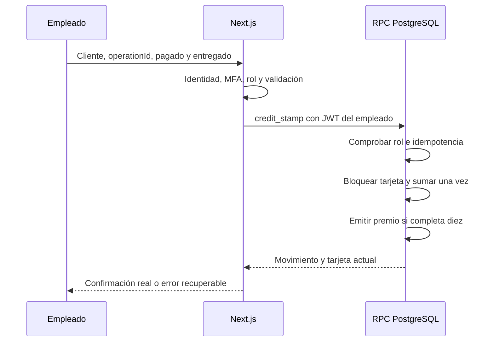

# 02. Fidelización, sellos y recompensas

**Actualización del 10/10/2026:** el acceso del cliente es por enlace privado/QR, sin SMS; nombre y teléfono son datos declarados. [Diseño vigente](16-acceso-a-tarjeta-sin-sms.md) sustituye las menciones anteriores a OTP, identidad telefónica Auth y `phone_change` del cliente. MFA del personal se conserva.

**Versión:** 1.1 · **Fecha:** 3 de octubre de 2026.  
**Relacionado:** [Decisiones](README.md), [Modelo](03-modelo-de-datos.md), [Operaciones](05-contratos-y-operaciones.md).

## 1. Regla vigente

Participación opcional, teléfono verificado y una tarjeta por cliente. Cada **visita presencial con compra pagada y pedido entregado** genera un sello cuando el personal lo confirma. La entrega es una aclaración posterior al análisis: no se acredita al tomar la orden ni al cobrar anticipadamente.

Una visita puede incluir varios platos y genera un solo sello. No se convierten importes en puntos. Una apertura de WhatsApp, una solicitud remota o una cancelación antes de entregar no acredita sellos. Una compra iniciada por WhatsApp puede contar si termina en una visita presencial elegible.

Diez sellos generan un Mostrito de ⅛ con chaufa, papas fritas y ensalada. El premio se usa en una visita posterior, sin exigir compra. Sellos y premios no vencen en la configuración inicial; no se introduce una caducidad oculta. Activación pública condicionada a costo, identidad y condiciones de participación.

## 2. Progreso y premios independientes

La tarjeta conserva `net_stamps`, número de acreditaciones válidas después de reversiones aplicadas. Para la versión inicial:

```text
progress = net_stamps % 10
qualified_reward_count = floor(net_stamps / 10)
available_rewards = premios con estado available
```

`qualified_reward_count` no es el saldo de canjes: los premios son registros independientes. Una entrega de regalo cambia el premio, nunca reinicia el progreso actual.

| Acreditaciones válidas | Progreso | Premios emitidos | Sin canjes |
| ---: | --- | ---: | ---: |
| 0 | 0/10 | 0 | 0 disponibles |
| 9 | 9/10 | 0 | 0 disponibles |
| 10 | 0/10 | 1 | 1 disponible |
| 11 | 1/10 | 1 | 1 disponible |
| 20 | 0/10 | 2 | 2 disponibles |

Un premio puede estar `available`, `redeemed` o `voided`. Una reversión puede anular un premio no entregado; un canje confirmado no se borra ni vuelve automáticamente a disponible.

## 3. Identificación y acreditación

Atención busca el teléfono completo, normalizado a E.164, dentro de su sección privada. No dispone de un directorio público ni búsqueda parcial. Comprueba nombre/tarjeta mostrada y último movimiento. Si no hay perfil activo, invita a activarlo; no crea una tarjeta a nombre de otra persona ni asigna sellos por nombre.

El formulario exige confirmar **pagado** y **entregado**, y permite referencia de atención o comprobante cuando exista. No solicita platos ni importe. Genera `operationId` una sola vez y lo conserva hasta resolver el resultado. La referencia, cuando se usa, es única por tarjeta para las acreditaciones activas.



Un UUID evita repetir la **misma operación**; no demuestra que dos operaciones con UUID distintos correspondan a visitas distintas. Sin POS, el reconocimiento de la visita real corresponde al personal. La interfaz muestra movimientos recientes y una referencia repetida bloquea otra acreditación. No se impone un límite por día: dos visitas reales diferentes pueden contar.

## 4. Canje y entrega física

Atención selecciona un premio específico, comprueba disponibilidad y confirma que corresponde a una visita posterior. No se sustituye «posterior» por «día siguiente»: puede ser otra visita real el mismo día. El sistema no puede verificar físicamente esa separación; registra la confirmación del empleado.

La RPC comprueba que el premio sigue disponible y que la operación no es la acreditación que lo originó. Dos empleados que intenten consumir el mismo premio obtienen un solo canje. Después de confirmar el resultado, el personal entrega el Mostrito; si el resultado es incierto, consulta el movimiento antes de intentar nuevamente o entregar dos veces.

Si el producto está agotado, el premio permanece disponible. Un canje solo no suma sello. Si hay una nueva compra pagada y entregada en esa visita, se acredita mediante otra operación explícita. El programa no exige esa compra para entregar el regalo.

La confirmación digital y la entrega física no forman una transacción distribuida. Si el canje quedó registrado y cocina no entrega el producto, se abre incidencia. **DC-13 aprobada el 11/10/2026 resuelve PT-13:** solo administrador con MFA confirma no entrega y motivo; restituye el mismo premio sin sumar sellos ni borrar el canje original, y cierra el caso en una transacción. No existe botón del mozo para deshacer canjes. [Contratos y límites H7](17-administracion-y-operacion-h7.md).

## 5. Correcciones e incidencias

Solo el responsable puede revertir una acreditación errónea. Debe elegir el evento original y escribir motivo. La reversión añade un evento `stamp_reversed`; no elimina el original. No se puede revertir dos veces la misma acreditación.

Con tarjeta bloqueada se calcula el saldo posterior. Si la nueva cantidad reduce premios calificados, se anulan los premios `available` con ordinal superior al nuevo umbral y se registran eventos `reward_voided`. Ejemplo: 10 sellos y un premio disponible pasan a 9/10 y ningún premio disponible. Si otro sello vuelve a completar el ordinal, se restaura el mismo registro de premio y se agrega `reward_restored`, conservando su historial.

Si una reversión quitaría respaldo a un premio `redeemed`, **no se aplica automáticamente**: se registra una incidencia `correction_requires_review` y se devuelve `review_required`, con saldo sin cambios. No se descuenta una deuda, no se elimina el canje y no se afirma que la corrección se aplicó. La resolución comercial excepcional la revisa el responsable; cerrar una incidencia con nota no modifica contadores. Cualquier ajuste adicional requiere una operación diseñada y aceptada aparte.

De acuerdo con DC-09, las cancelaciones anteriores a la entrega no llegan a este flujo. Una devolución posterior a la entrega no se detecta automáticamente y se trata como incidencia de revisión; no se inventa una política de devoluciones del negocio.

## 6. Identidad, cambio de número y caídas

La tarjeta pertenece al UUID del cliente, vinculado al usuario de Auth; no depende de su nombre ni se recrea al cambiar de teléfono. El cambio normal requiere sesión y verificación del número nuevo. El teléfono confirmado de Auth es la única fuente; no se mantiene una copia editable en el perfil. Después del cambio, atención encuentra la misma tarjeta por el número nuevo, aunque el navegador se cierre antes de refrescarla. Si el número ya está vinculado a otra identidad, no se fusionan tarjetas automáticamente.

Sin enlace privado, DC-14 aprueba recuperación presencial por administrador: comprobante/referencia contrastada con visita no revertida del historial de esa tarjeta, presencia/titularidad y motivo. Rota clave y conserva UUID/progreso/premios. Teléfono solo no prueba identidad, no hay recuperación pública ni traslado de saldo. Sin evidencia suficiente se escala para revisión. DC-15 excluye baja de clientes/tarjetas; términos/aviso/plazos quedan en PT-11.

En una caída, la compra continúa. Atención anota una incidencia interna con referencia de visita, fecha, identidad mínima y confirmación de entrega. No promete un sello registrado. Al recuperar el servicio, el responsable revisa duplicados y registra la visita con su fecha real y el identificador de contingencia. Se distinguen fecha de entrega y fecha de registro. No hay sincronización automática offline.

## 7. Versiones y cambios de reglas

`loyalty_program_versions` conserva la meta y el contenido del premio. Una regla activa no cambia retrospectivamente. Cada tarjeta queda vinculada a su versión; un premio conserva una copia de las inclusiones ganadas. El panel inicial permite activación con costo/condiciones confirmadas y disponibilidad/costo operativo, no editar metas o crear premios alternativos.

Un cambio futuro crea otra versión. Las tarjetas existentes permanecen en su regla hasta un procedimiento de transición aceptado; no se convierten saldos ni se borran premios mediante una actualización masiva. El esquema permite versiones, pero no implementa un motor general de campañas.

## 8. Alternativas y evidencia

La revisión documental distingue uso observable de eficacia causal. Los ejemplos siguientes no prueban rentabilidad en Parcona ni justifican copiar sus condiciones.

| Enfoque | Referencia | Lectura para este negocio |
| --- | --- | --- |
| Sellos y premio final | [Greggs](https://www.greggs.com/app) entrega el décimo producto de una categoría tras nueve sellos. Su [informe H1 2025](https://s204.q4cdn.com/833746791/files/doc_news/Interim-Results-2025.pdf) registra escaneo de la app en 25,7 % de transacciones de locales propios frente a 18,3 % un año antes. | Evidencia de adopción, no de ventas incrementales causadas por el programa. Se conserva nuestra meta de diez visitas. |
| Premios intermedios | [Nando’s](https://www.nandos.co.uk/rewards) utiliza hitos de 3, 6 y 10. | Candidato para una segunda prueba: un beneficio pequeño al quinto sello y Mostrito al décimo. Producto y costo todavía sin aprobar. |
| Puntos por gasto | [Chipotle Rewards](https://www.chipotle.com/order/rewards) acumula puntos por importe; [comunicó 21 millones de miembros activos en abril de 2026](https://ir.chipotle.com/2026-04-13-CHIPOTLE-RELAUNCHES-REWARDS-WITH-REWARDS-ON-REPEAT,-DELIVERING-MORE-VALUE-WITHOUT-TRADE-OFFS). | Reconoce tickets mayores, pero obliga a registrar importes y devoluciones. Amplía el alcance actual y no se incorpora al MVP. |

Se recomienda lanzar el programa simple y evaluar un beneficio intermedio después del piloto. No se agregan cumpleaños, campañas automáticas, niveles ni descuentos por registro.

## 9. Costos y métricas

Antes de activar, el propietario proporciona costo de ingredientes, preparación, empaque y acompañamientos del premio. El precio de venta de P01 no es su costo. Con todos los premios canjeados, el costo variable de recompensa por visita elegible es el costo del Mostrito dividido entre diez, sin incluir OTP y operación.

Medir desde movimientos: visitas acreditadas por participante, días entre visitas, días hasta premio, premios emitidos/canjeados y costo estimado de regalos efectivamente entregados, con costo de referencia guardado en cada canje. Registrar cohortes y periodo observado; comparar participantes no demuestra causalidad ni incluye todas las ventas. Sin montos de venta, la aplicación no calcula ticket promedio ni margen incremental.

Verificar con [pruebas](08-pruebas-y-aceptacion.md): noveno/décimo/undécimo sello, veinte sellos, duplicados, dos visitas concurrentes, dos canjes concurrentes, agotamiento, reversión y resultado incierto.
