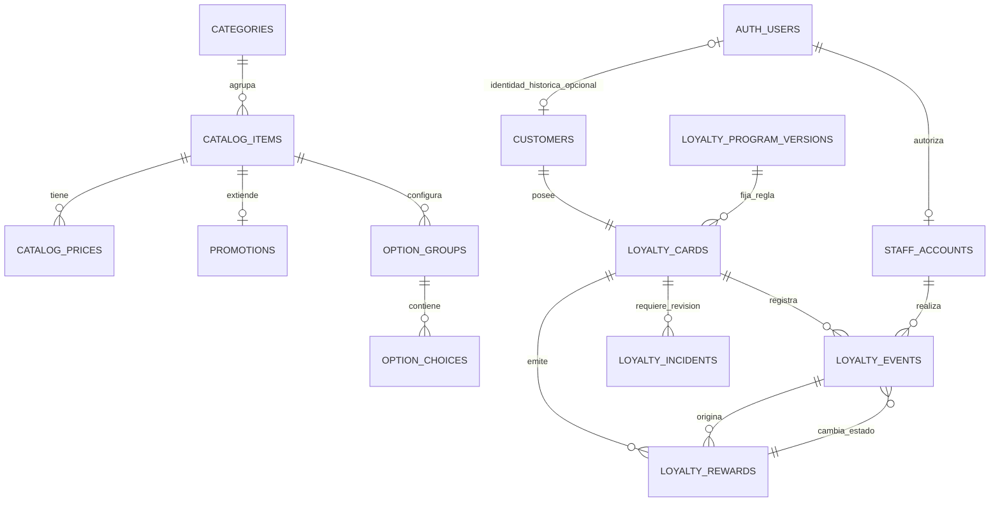

# 03. Modelo de datos y migraciones

**Actualización DC-22, 13/10/2026:** [personal sin MFA](19-acceso-del-personal-sin-mfa.md) sustituye los requisitos de segundo factor, enrolamiento y AAL2 de este documento. Acceso con correo/contraseña, cuenta activa y rol vigente; cliente sin SMS. Evidencia histórica conserva las reglas comprobadas en su fecha.

**Actualización del 10/10/2026:** el acceso del cliente es por enlace privado/QR, sin SMS; nombre y teléfono son datos declarados. [Diseño vigente](16-acceso-a-tarjeta-sin-sms.md) sustituye las menciones anteriores a OTP, identidad telefónica Auth y `phone_change` del cliente. El acceso actual del personal se define en DC-22.

**Versión:** 1.1 · **Fecha:** 3 de octubre de 2026.  
**Relacionado:** [Fidelización](02-fidelizacion.md), [Permisos](04-autenticacion-seguridad.md), [Contratos](05-contratos-y-operaciones.md).

## 1. Convenciones y límites

**H7 / DC-12–15:** [Modelo ampliado](17-administracion-y-operacion-h7.md), sin tablas nuevas. Staff añade estado/reserva de envío de invitación; eventos añaden reinstates_event_id y reward_reinstated. Se conserva canje original y UUID del premio al restituirlo. Baja de clientes/tarjetas excluida del producto por decisión expresa del propietario.

PostgreSQL de Supabase es la fuente de verdad. UUID para PK; `timestamptz` UTC para eventos; moneda única PEN e importes `integer` en céntimos, nunca `float`. Texto libre se recorta y limita; se trata como texto, sin HTML. `created_at` y `updated_at` usan hora del servidor. Filas mutables de catálogo/perfil incluyen `revision integer >= 1` para control de concurrencia.

`public` contiene las tablas comerciales, incluidos borradores y precios fuente. Solo la proyección `read_catalog()` se publica; no se concede lectura directa de esas tablas a `anon`/`authenticated`. `app_private` contiene personas, roles, tarjetas y auditoría; no se añade a los esquemas expuestos por Data API. Las RPC están en `public`, con permisos específicos. [Seguridad](04-autenticacion-seguridad.md) define permisos y políticas, no el nombre del esquema por sí solo.

No hay tablas de pedidos, líneas de compra, direcciones, pagos realizados ni mensajes de WhatsApp. El costo del premio y las referencias de atención no constituyen un historial de platos vendidos.

## 2. Diagrama de relaciones

Los nombres del diagrama representan las tablas descritas abajo; `AUTH_USERS` corresponde a `auth.users`, administrada por Supabase.

## 3. Catálogo público

En las tablas siguientes, ID UUID y fechas se incluyen salvo que se indique otra PK.

| Tabla | Campos principales | Restricciones |
| --- | --- | --- |
| `categories` | `id`, `slug`, `name`, `sort_order`, `active`, `revision`. | Slug único; orden >= 0. Seis familias y categoría de promociones. |
| `catalog_items` | `id`, `source_ref`, `category_id`, `slug`, `name`, `kind`, `portion_label`, `inclusions text[]`, `description`, `image_path`, `source_price_cents`, `online_enabled`, `publication_status`, `availability`, `sort_order`, `revision`. | FK categoría; slug y `source_ref` únicos; `kind=regular|promotion`; `publication_status=draft|published|archived`; `availability=available|sold_out`; importes >= 0. |
| `catalog_prices` | `id`, `item_id`, `mode`, `price_cents`, `verified`, `revision`. | Único `(item_id,mode)`; `mode=delivery|pickup|dine_in`; precio > 0 para venta. `dine_in` nunca se acepta en checkout web. |
| `promotions` | `item_id` como PK/FK, `enabled`, `starts_at`, `ends_at`, `weekdays smallint[]`, `previous_price_cents`, `comparison_verified`, `revision`. | Solo item de tipo promoción; fin > inicio; días ISO 1–7 sin duplicados. Precio anterior > precio aplicable cuando se muestra. |
| `option_groups` | `id`, `item_id`, `name`, `min_choices`, `max_choices`, `active`, `verified`, `sort_order`, `revision`. | `0 <= min <= max`; max >= 1; FK item. No publicar grupo requerido sin suficientes elecciones verificadas. |
| `option_choices` | `id`, `group_id`, `label`, `extra_price_cents`, `available`, `verified`, `sort_order`, `revision`. | Recargo >= 0; FK grupo; selección única por línea. No se permiten cantidades por opción en v1. |

Longitudes máximas: nombre/etiqueta 120 caracteres, slug 120, porción 80, descripción 500; hasta 12 inclusiones de 120 caracteres. Son límites técnicos, no datos comerciales. `image_path` es relativo al bucket oficial; no acepta una URL arbitraria.

`source_price_cents` conserva el precio de la imagen para trazabilidad; **no es el precio autorizado de checkout**. Este se obtiene de `catalog_prices` verificado para la modalidad elegida. Un item se publica solo con datos mínimos completos y al menos un precio online verificado. La disponibilidad puede cambiar sin archivar.

Una promoción sin fechas conocidas usa nulos y activación manual; no se inventa vencimiento. Empieza inclusive y termina exclusive. Días se interpretan en `America/Lima`. Las modalidades permitidas son las filas de precio verificadas, evitando dos fuentes contradictorias de compatibilidad. P05 solo tiene precio online de `delivery`.

`read_catalog()` omite promociones desactivadas o fuera de vigencia y conserva los artículos agotados para mostrar su estado. Un precio anterior aparece únicamente si `comparison_verified=true`, las inclusiones/modalidades comparadas corresponden y supera el precio de esa modalidad. Un cambio de contenido, modalidad o precio invalida esa verificación salvo confirmación explícita en la misma edición. En v1 solo P05 tiene comparación documentada; no se deduce un descuento entre C y P.

Restricciones de una misma fila se implementan con CHECK/UNIQUE/FK. Las que comparan tablas, como tipo de item de una promoción, suficiencia de opciones o comparación con precio vigente, se validan dentro de la RPC y, cuando protejan integridad fuera de ella, con triggers. No escribir CHECK con consultas a otra tabla.

Las referencias C07–C11 son cinco entradas distintas de cuatro alitas. No se deduplican ni se introduce un selector que cambie su identidad sin confirmar el negocio. Opciones de ronda, presa o gaseosa empiezan sin grupos habilitados hasta validación comercial.

## 4. Configuración pública del negocio

| Tabla | Campos y significado |
| --- | --- |
| `business_settings` | Singleton `id=1`; `display_name`, `whatsapp_e164`, `timezone`, `address`, `maps_url`, `location_verified`, `schedule_confirmed`, `opening_periods jsonb`, `pickup_extra_cents` nullable, `pickup_charges_verified`, `ordering_enabled`, `loyalty_enabled`, `revision`. Sin claves ni costos privados. |
| `payment_methods` | UUID, `code`, `label`, `instructions`, `needs_change`, `enabled`, `verified`, `sort_order`, `revision`. Código único. Solo métodos confirmados aparecen públicamente. |
| `delivery_zones` | UUID, `name`, `coverage=allowed|excluded`, `fee_cents` nullable, `minimum_subtotal_cents` nullable, `enabled`, `verified`, `revision`. Tarifa nula significa pendiente, cero significa gratuidad confirmada. |

`whatsapp_e164` inicial confirmado: `+51982042493`. La URL se construye exclusivamente para ese número/configuración validada. `timezone=America/Lima`, valor técnico para Parcona. Dirección, horarios y métodos se dejan sin confirmar si faltan.

Cada periodo horario tiene `{day, opensAt, closesAt, closesNextDay}`, con día ISO y horas `HH:mm`; los periodos confirmados se validan sin solapamientos. Se soporta cruce de medianoche explícito. Sin horario confirmado el estado es `unknown`, no abierto ni cerrado. `ordering_enabled=false` pausa la preparación; no fabrica un horario.

Zonas se habilitan solo cuando estén confirmadas. Sin tabla habilitada, dirección libre y cobertura/cargo pendientes. No se infiere cobertura por texto de calle ni GPS. Una zona excluida bloquea esa modalidad, una zona permitida con costo desconocido conserva total pendiente. Los tests con zona y tarifa sintéticas no se siembran en producción.

Para recojo, `pickup_extra_cents` solo se usa si `pickup_charges_verified=true`; cero expresa ausencia de cargo confirmada por el negocio. En cualquier otro caso cargo y total final siguen pendientes, conforme al análisis. No se introduce una tarifa de recojo como condición comercial nueva.

## 5. Identidades privadas

| Tabla | Campos principales | Restricciones |
| --- | --- | --- |
| `app_private.customers` | `id`, `auth_user_id` nullable, `contact_phone`, `access_key_hash`, `access_key_expires_at`, nombre/indicaciones/estado/términos/revisión/fechas/soft delete. | Clave privada y contacto normalizado para nuevas altas; Auth solo compatibilidad. Hash/telefono únicos globales; pareja hash/vigencia; perfil activo con nombre e identidad válida. |
| `app_private.staff_accounts` | `id`, `auth_user_id`, `role=attendant|manager`, `active`, `created_by`, `revision`, fechas. | Auth único; FK `ON DELETE RESTRICT`; no borrar personal con historial, desactivar. |
| `app_private.loyalty_program_versions` | `id`, `code`, `target_stamps`, `reward_name`, `reward_contents text[]`, `reward_cost_cents` nullable, `reward_available`, `terms_version`, `status=draft|active|retired`, `revision`, fechas. | Código único; costo >= 0; versión inicial meta 10. Meta/contenido inmutables tras activación; disponibilidad y costo operativo pueden revisarse por responsable. Solo una versión activa para altas nuevas. |

El alta actual obtiene la clave del servidor y envía solo su hash a `ensure_card_by_key`. El teléfono declarado no autoriza consulta: `get_card_by_key` y edición propia solo pueden ejecutarse desde servidor con clave validada. `lookup_customer` exige personal/permisos; cambio de contacto conserva UUID y exige revisión. [Definición completa](16-acceso-a-tarjeta-sin-sms.md).

La baja cierra perfil y tarjeta y elimina nombre/indicaciones antes de una eventual desvinculación o eliminación de Auth. El teléfono se retira de Auth mediante su procedimiento administrado, sin afectar una identidad que también sea personal activo. Las referencias pseudónimas necesarias para auditoría se conservan hasta definir la retención. No se promete anonimato absoluto ni se borra una cadena de canjes mediante `CASCADE`. La política real y el tratamiento de una identidad con ambos usos son PT-11; un perfil cerrado no se reactiva automáticamente al iniciar sesión.

## 6. Tarjetas, eventos y premios

| Tabla | Campos principales | Restricciones |
| --- | --- | --- |
| `app_private.loyalty_cards` | `id`, `customer_id`, `program_version_id`, `net_stamps`, `status=active|suspended|closed`, `revision`, fechas. | Una por cliente; FKs; saldo >= 0. Regla de versión fija. |
| `app_private.loyalty_events` | `id`, `card_id`, `actor_staff_id`, `operation_id`, `event_type`, `stamp_delta`, `reward_id` nullable, `reverses_event_id` nullable, `visit_reference` nullable, `reward_cost_cents_snapshot` nullable, `occurred_at`, `recorded_at`, `reason` nullable. | Append-only; `stamp_credited=+1`, `stamp_reversed=-1`, eventos de premio=0. Una reversión por evento original mediante índice único parcial. Costo no negativo solo para canje. |
| `app_private.loyalty_rewards` | `id`, `card_id`, `program_version_id`, `ordinal`, `issued_stamp_event_id`, `reward_name_snapshot`, `reward_contents_snapshot`, `status=available|redeemed|voided`, `issued_at`, `redeemed_at` nullable, `redeemed_by` nullable, `revision`. | Único `(card_id,ordinal)`; ordinal >= 1; premio emitido por acreditación de la misma tarjeta. Canjeado exige fecha y empleado. |
| `app_private.loyalty_incidents` | `id`, `card_id`, `source_event_id` nullable, `reward_id` nullable, `opened_by`, `type`, `description`, `status=open|closed`, `resolution_note`, `closed_by`, fechas. | FK de actores; cierre requiere responsable, fecha y nota. No modifica contador ni estado del premio. |

Tipos de evento: `stamp_credited`, `stamp_reversed`, `reward_issued`, `reward_redeemed`, `reward_voided`, `reward_restored`. Una llamada puede crear varios eventos, identificados por el mismo `operation_id`. Originales y reversiones quedan visibles al responsable; el cliente recibe una proyección sin datos de empleados ni referencias internas.

Un trigger rechaza UPDATE/DELETE ordinarios en eventos, recibos confirmados y auditoría. Las proyecciones de tarjeta/premio sí se actualizan mediante sus funciones transaccionales. Un mantenimiento excepcional o purga aprobada no se presenta como una operación del panel.

`net_stamps` es una proyección mantenida en la misma transacción que los eventos, no un campo editable. Una comprobación de integridad compara suma de deltas y contador. El saldo de premios se deriva de registros disponibles, no de restar canjes a un contador independiente. El evento de canje conserva costo de referencia vigente para estimar entregas sin recalcular premios pasados con un costo nuevo; ese campo no se expone al cliente.

Integridad entre tarjetas y premios: FK compuesta `(reward_id,card_id)` a `(id,card_id)` en `loyalty_rewards`, y equivalente para evento original. `issued_stamp_event_id` debe referir `stamp_credited`; una función/trigger verifica tipo y tarjeta. El sello se inserta primero, luego premio y evento `reward_issued`, evitando FK circular de creación.

El registro del premio es una proyección mutable con historial inmutable. Al restaurar un ordinal anulado se reutiliza su ID y se registra `reward_restored`; nunca se crea otro premio con ese ordinal. Un canjeado no se restaura por este mecanismo.

## 7. Idempotencia y auditoría

| Tabla | Campos | Uso |
| --- | --- | --- |
| `app_private.operation_receipts` | `id`, `actor_user_id`, `operation_id`, `operation_kind`, `request_hash`, `outcome jsonb`, `created_at`. Único `(actor_user_id,operation_id)`. | Resultado de mutación confirmada; hash de entrada normalizada sin OTP, dirección ni contenido de pedido. |
| `app_private.audit_entries` | `id`, `actor_staff_id` nullable, `actor_user_id`, `action`, `entity_type`, `entity_id`, `changed_fields jsonb`, `reason` nullable, `operation_id` nullable, `created_at`. | Cambios comerciales, autorizaciones e identidad. No guardar textos de preferencias, contraseñas, códigos ni cuerpos de solicitud. |

El resultado de operación contiene IDs y estado aplicado, no copia completa del perfil. Reutilizar un identificador con otra entrada devuelve `IDEMPOTENCY_CONFLICT`. Fallos previos al commit no crean recibo de éxito. Una incidencia de revisión creada sí produce resultado `review_required` y recibo; los reintentos no crean otra incidencia.

La referencia de visita se normaliza sin espacios externos y tiene hasta 80 caracteres. Su unicidad entre acreditaciones activas se controla dentro del bloqueo de tarjeta consultando eventos no revertidos; el identificador de operación evita duplicación de la misma petición. La referencia puede reutilizarse después de una reversión solo mediante confirmación consciente y deja ambos eventos trazables.

## 8. Índices y eliminación

Índices: FK de categoría/item/grupo; precios únicos por modalidad; `customers(auth_user_id)` único; `staff_accounts(auth_user_id)` único; eventos `(card_id,recorded_at desc,id)` y `(id,card_id)` único para FK compuesta de reversión; premios `(card_id,status,ordinal)` y `(id,card_id)` únicos; recibos `(actor_user_id,operation_id)` únicos; incidencias `(status,created_at)` y `(card_id,created_at)`. La búsqueda usa el índice único `contact_phone`; `access_key_hash` es UNIQUE. Auth conserva sus índices administrados para compatibilidad, sin modificaciones.

Catálogo publicado se archiva, no elimina. Se permite borrar opciones de borrador sin referencias activas; preferir desactivación para carritos antiguos. No borrar eventos, premios o actores usados mediante el panel. Cualquier purga futura se diseña contra PT-11 y preserva integridad.

## 9. Migraciones y seed

Orden de migraciones futuras: esquemas/extensiones → catálogo/configuración → identidades/tarjetas → eventos/premios/recibos → constraints/índices → funciones/autorización → RLS y permisos → seed comercial. Las funciones de seguridad no quedan temporalmente expuestas con permisos por defecto.

`source_ref` conserva C01–C24 y P01–P05 como referencia documental, sin convertirlos en PK. Seed reproducible con UUID estables y siete categorías. C01 se conserva con `online_enabled=false`, precio fuente 1000 y sin precio web. Las demás filas conservan los importes del análisis en céntimos: P01=1490, P02/P03=4490, P04=5990, P05=8990 y anterior de P05=11000.

Se cargan cuatro alitas en C07–C11 y dieciséis en P03; no se fusionan equivalencias pendientes. La semilla de producción no marca como verificado un precio/modalidad/inclusión no confirmado. La vigencia comercial recibida no equivale a configuración totalmente lista: publicaciones se activan tras revisión PT-05.

Fixtures locales separadas usan teléfonos ficticios, pagos, zonas y horarios sintéticos. No crean usuarios Auth reales ni claves en un seed compartido. Generar `Database` desde esquema migrado para TypeScript; revisar diff y contratos después de cada cambio.

Versionar SQL con [migraciones de Supabase](https://supabase.com/docs/guides/deployment/database-migrations). Este documento define su contenido; no se ejecutan migraciones durante esta etapa.
