# 10. Tablas de base de datos, E-R y soft delete

**Actualización 21/10/2026 — DC-23–25:** [pedido por WhatsApp sin pago y costo de premio opcional](20-pedido-whatsapp-y-costo-opcional.md) sustituye los campos/requisitos de pago y la obligatoriedad del costo de las definiciones anteriores.

**Actualización DC-22, 13/10/2026:** [personal sin MFA](19-acceso-del-personal-sin-mfa.md) sustituye los requisitos de segundo factor, enrolamiento y AAL2 de este documento. Acceso con correo/contraseña, cuenta activa y rol vigente; cliente sin SMS. Evidencia histórica conserva las reglas comprobadas en su fecha.

**Actualización del 10/10/2026:** el acceso del cliente es por enlace privado/QR, sin SMS; nombre y teléfono son datos declarados. [Diseño vigente](16-acceso-a-tarjeta-sin-sms.md) sustituye las menciones anteriores a OTP, identidad telefónica Auth y `phone_change` del cliente. El acceso actual del personal se define en DC-22.

**Versión:** 1.3 · **Fecha:** 11 de octubre de 2026.  
**Estado:** 18 tablas propias aplicadas en H1–H7; diccionario actualizado con contacto/clave privada, invitaciones y restitución supervisada. Alcance y resultados en [evidencia H7](../implementacion/evidencia/h7/README.md).
**Base:** [Análisis](../analisis-del-proyecto.md), [Modelo original](03-modelo-de-datos.md), [Seguridad](04-autenticacion-seguridad.md) y [Contratos](05-contratos-y-operaciones.md).  
**Complementos:** [Flujo funcional](11-diagrama-flujo.md), [Navegación](12-flujo-navegacion.md) y [Carpetas](13-estructura-carpetas.md).

## 1. Alcance y precedencia

**H7 / DC-12–15:** [Contratos vigentes](17-administracion-y-operacion-h7.md). Se conservan dieciocho tablas y metadatos SQL, pero baja/restauración de clientes y tarjetas queda excluida por el propietario: las RPC la rechazan, sin purgas ni baja Auth. Staff añade invitation_status (text, ready/pending/sent, NOT NULL DEFAULT ready, pending exige active=false) e invitation_send_started_at (timestamptz nullable) para conciliación de invitaciones. Eventos añaden reward_reinstated y reinstates_event_id (uuid nullable, FK compuesta misma tarjeta y UNIQUE parcial); este campo y motivo son obligatorios solo para restituir el canje original. Estos detalles actualizan el E-R/diccionario anteriores, sin modificar entidades ni el resto de sus permisos.

Este documento desarrolla el diccionario de las **18 tablas de la aplicación** y añade el soft delete solicitado. Los documentos 01–09 se conservan como antecedentes. Para eliminación y restauración, esta especificación sustituye la indicación anterior de borrar opciones de borrador o limitarse a archivar, sin cambiar las reglas comerciales de sellos, premios y pedidos.

Hay nueve tablas comerciales en `public` y nueve internas en `app_private`. Catorce conservan metadatos de borrado lógico; DC-15 excluye su operación en clientes/tarjetas. Tres son registros inmutables; una es configuración única protegida. Supabase administra `auth.users` y Storage: se describen sus referencias, sin ampliar sus esquemas ni contabilizarlos como tablas propias.

No se crean tablas de pedidos, líneas vendidas, direcciones de clientes, pagos realizados ni mensajes. El carrito y el borrador permanecen en el dispositivo. Las preferencias guardadas son indicaciones declaradas, no un historial de platos comprados.

## 2. Convenciones del diccionario

| Convención | Definición |
| --- | --- |
| Identificadores | `uuid`, generado con `gen_random_uuid()` salvo PK que también es FK. No cambia al eliminar/restaurar. |
| Texto | `text` con límites CHECK y validación de entrada; recortar espacios externos. No admitir HTML como contenido ejecutable. |
| Tiempo | `timestamptz`; hora del servidor, instantes UTC. Horarios y días comerciales se interpretan en `America/Lima`. |
| Dinero | `integer` en céntimos de PEN. `1490` representa S/14.90. Nunca `float`; `NULL` significa desconocido, no gratis. |
| Estados | `text` con CHECK de valores enumerados en cada tabla. No depender exclusivamente de enums TypeScript. |
| Concurrencia | `revision integer NOT NULL DEFAULT 1`, CHECK >= 1. Toda mutación efectiva aumenta la revisión y actualiza `updated_at`. |
| Fechas comunes | `created_at` y `updated_at` son `timestamptz NOT NULL DEFAULT now()` en tablas mutables. La aplicación no recibe su valor como autoridad. |
| Claves foráneas | `ON UPDATE NO ACTION`; `ON DELETE RESTRICT`, salvo la excepción explícita de `customers.auth_user_id`. No usar cascadas físicas. |
| Visibilidad | Existencia, publicación, verificación, disponibilidad y borrado son estados distintos. `deleted_at IS NULL` no basta para vender un artículo. |
| Valores iniciales | Publicación en borrador; flags de habilitación/verificación en falso. Los importes pendientes y datos comerciales sin confirmar permanecen nulos o sin verificar. |

En las tablas de campos, **No** significa NOT NULL; **Sí** permite NULL. «Entrada» significa valor obligatorio sin DEFAULT SQL. «Servidor» indica valor obtenido del contexto validado de la operación, sin DEFAULT implícito. Las filas comunes se repiten para que cada tabla pueda consultarse por separado.

Límites técnicos completados aquí: códigos internos 1–80; slugs 1–120 con minúsculas, números y guiones; nombres de catálogo 1–120; porción 1–80; descripción hasta 500; hasta 12 inclusiones no vacías de máximo 120 cada una. Son límites de almacenamiento, sin introducir condiciones comerciales nuevas. Texto opcional vacío se normaliza a NULL salvo indicaciones, cuyo valor vacío es `''`.

## 3. Diagrama entidad-relación

Los identificadores en mayúsculas corresponden a las tablas del inventario de la sección 4. `AUTH_USERS` representa únicamente los campos externos consultados. `text_array` y `smallint_array` son las etiquetas Mermaid para `text[]` y `smallint[]`. PK/FK/UK señalan claves; las claves compuestas y sus condiciones se detallan en el diccionario. Relaciones discontinuas son no identificadoras; la extensión de promoción usa una relación identificadora porque su PK también es la FK al artículo.

```mermaid
erDiagram
    CATEGORIES ||..o{ CATALOG_ITEMS : category_id
    CATALOG_ITEMS ||..o{ CATALOG_PRICES : item_id
    CATALOG_ITEMS ||--o| PROMOTIONS : item_id
    CATALOG_ITEMS ||..o{ OPTION_GROUPS : item_id
    OPTION_GROUPS ||..o{ OPTION_CHOICES : group_id
    AUTH_USERS o|..o| CUSTOMERS : identidad_historica_opcional
    AUTH_USERS ||..o| STAFF_ACCOUNTS : auth_user_id
    CUSTOMERS ||..o| LOYALTY_CARDS : customer_id
    LOYALTY_PROGRAM_VERSIONS ||..o{ LOYALTY_CARDS : program_version_id
    LOYALTY_PROGRAM_VERSIONS ||..o{ LOYALTY_REWARDS : program_version_id
    LOYALTY_CARDS ||..o{ LOYALTY_EVENTS : card_id
    LOYALTY_CARDS ||..o{ LOYALTY_REWARDS : card_id
    LOYALTY_CARDS ||..o{ LOYALTY_INCIDENTS : card_id
    STAFF_ACCOUNTS ||..o{ LOYALTY_EVENTS : actor_staff_id
    STAFF_ACCOUNTS o|..o{ STAFF_ACCOUNTS : created_by
    STAFF_ACCOUNTS o|..o{ LOYALTY_REWARDS : redeemed_by
    STAFF_ACCOUNTS ||..o{ LOYALTY_INCIDENTS : opened_by
    STAFF_ACCOUNTS o|..o{ LOYALTY_INCIDENTS : closed_by
    STAFF_ACCOUNTS o|..o{ AUDIT_ENTRIES : actor_staff_id
    LOYALTY_EVENTS ||..o{ LOYALTY_REWARDS : issued_stamp_event_id
    LOYALTY_EVENTS o|..o| LOYALTY_EVENTS : reverses_event_id
    LOYALTY_EVENTS o|..o| LOYALTY_EVENTS : reinstates_event_id
    LOYALTY_REWARDS o|..o{ LOYALTY_EVENTS : reward_id
    LOYALTY_EVENTS o|..o{ LOYALTY_INCIDENTS : source_event_id
    LOYALTY_REWARDS o|..o{ LOYALTY_INCIDENTS : reward_id
    STAFF_ACCOUNTS o|..o{ CATEGORIES : deleted_by
    STAFF_ACCOUNTS o|..o{ CATALOG_ITEMS : deleted_by
    STAFF_ACCOUNTS o|..o{ CATALOG_PRICES : deleted_by
    STAFF_ACCOUNTS o|..o{ PROMOTIONS : deleted_by
    STAFF_ACCOUNTS o|..o{ OPTION_GROUPS : deleted_by
    STAFF_ACCOUNTS o|..o{ OPTION_CHOICES : deleted_by
    STAFF_ACCOUNTS o|..o{ PAYMENT_METHODS : deleted_by
    STAFF_ACCOUNTS o|..o{ DELIVERY_ZONES : deleted_by
    STAFF_ACCOUNTS o|..o{ CUSTOMERS : deleted_by
    STAFF_ACCOUNTS o|..o{ STAFF_ACCOUNTS : deleted_by
    STAFF_ACCOUNTS o|..o{ LOYALTY_PROGRAM_VERSIONS : deleted_by
    STAFF_ACCOUNTS o|..o{ LOYALTY_CARDS : deleted_by
    STAFF_ACCOUNTS o|..o{ LOYALTY_REWARDS : deleted_by
    STAFF_ACCOUNTS o|..o{ LOYALTY_INCIDENTS : deleted_by

    AUTH_USERS {
        uuid id PK
        text phone
        timestamptz phone_confirmed_at
    }
    CATEGORIES {
        uuid id PK
        text slug UK
        text name
        integer sort_order
        boolean active
        integer revision
        timestamptz created_at
        timestamptz updated_at
        timestamptz deleted_at
        uuid deleted_by FK
        text delete_reason
    }
    CATALOG_ITEMS {
        uuid id PK
        text source_ref UK
        uuid category_id FK
        text slug UK
        text name
        text kind
        text portion_label
        text_array inclusions
        text description
        text image_path
        integer source_price_cents
        boolean online_enabled
        boolean content_verified
        text publication_status
        text availability
        integer sort_order
        integer revision
        timestamptz created_at
        timestamptz updated_at
        timestamptz deleted_at
        uuid deleted_by FK
        text delete_reason
    }
    CATALOG_PRICES {
        uuid id PK
        uuid item_id FK
        text mode
        integer price_cents
        boolean verified
        integer revision
        timestamptz created_at
        timestamptz updated_at
        timestamptz deleted_at
        uuid deleted_by FK
        text delete_reason
    }
    PROMOTIONS {
        uuid item_id PK,FK
        boolean enabled
        timestamptz starts_at
        timestamptz ends_at
        smallint_array weekdays
        integer previous_price_cents
        boolean comparison_verified
        integer revision
        timestamptz created_at
        timestamptz updated_at
        timestamptz deleted_at
        uuid deleted_by FK
        text delete_reason
    }
    OPTION_GROUPS {
        uuid id PK
        uuid item_id FK
        text name
        integer min_choices
        integer max_choices
        boolean active
        boolean verified
        integer sort_order
        integer revision
        timestamptz created_at
        timestamptz updated_at
        timestamptz deleted_at
        uuid deleted_by FK
        text delete_reason
    }
    OPTION_CHOICES {
        uuid id PK
        uuid group_id FK
        text label
        integer extra_price_cents
        boolean available
        boolean verified
        integer sort_order
        integer revision
        timestamptz created_at
        timestamptz updated_at
        timestamptz deleted_at
        uuid deleted_by FK
        text delete_reason
    }
    BUSINESS_SETTINGS {
        smallint id PK
        text display_name
        text whatsapp_e164
        text timezone
        text address
        text maps_url
        boolean location_verified
        boolean schedule_confirmed
        jsonb opening_periods
        integer pickup_extra_cents
        boolean pickup_charges_verified
        boolean ordering_enabled
        boolean loyalty_enabled
        integer revision
        timestamptz created_at
        timestamptz updated_at
    }
    PAYMENT_METHODS {
        uuid id PK
        text code UK
        text label
        text instructions
        boolean needs_change
        boolean enabled
        boolean verified
        integer sort_order
        integer revision
        timestamptz created_at
        timestamptz updated_at
        timestamptz deleted_at
        uuid deleted_by FK
        text delete_reason
    }
    DELIVERY_ZONES {
        uuid id PK
        text name
        text coverage
        integer fee_cents
        integer minimum_subtotal_cents
        boolean enabled
        boolean verified
        integer revision
        timestamptz created_at
        timestamptz updated_at
        timestamptz deleted_at
        uuid deleted_by FK
        text delete_reason
    }
    CUSTOMERS {
        uuid id PK
        uuid auth_user_id FK,UK
        text contact_phone UK
        text access_key_hash UK
        timestamptz access_key_expires_at
        text display_name
        text frequent_instructions
        text status
        text terms_version
        timestamptz terms_accepted_at
        integer revision
        timestamptz created_at
        timestamptz updated_at
        timestamptz deleted_at
        uuid deleted_by FK
        text delete_reason
    }
    STAFF_ACCOUNTS {
        uuid id PK
        uuid auth_user_id FK,UK
        text role
        boolean active
        text invitation_status
        timestamptz invitation_send_started_at
        uuid created_by FK
        integer revision
        timestamptz created_at
        timestamptz updated_at
        timestamptz deleted_at
        uuid deleted_by FK
        text delete_reason
    }
    LOYALTY_PROGRAM_VERSIONS {
        uuid id PK
        text code UK
        integer target_stamps
        text reward_name
        text_array reward_contents
        integer reward_cost_cents
        boolean reward_available
        text terms_version
        text status
        integer revision
        timestamptz created_at
        timestamptz updated_at
        timestamptz deleted_at
        uuid deleted_by FK
        text delete_reason
    }
    LOYALTY_CARDS {
        uuid id PK
        uuid customer_id FK,UK
        uuid program_version_id FK
        integer net_stamps
        text status
        integer revision
        timestamptz created_at
        timestamptz updated_at
        timestamptz deleted_at
        uuid deleted_by FK
        text delete_reason
    }
    LOYALTY_EVENTS {
        uuid id PK
        uuid card_id FK
        uuid actor_staff_id FK
        uuid operation_id
        text event_type
        smallint stamp_delta
        uuid reward_id FK
        uuid reverses_event_id FK
        uuid reinstates_event_id FK
        text visit_reference
        integer reward_cost_cents_snapshot
        timestamptz occurred_at
        timestamptz recorded_at
        text reason
    }
    LOYALTY_REWARDS {
        uuid id PK
        uuid card_id FK
        uuid program_version_id FK
        integer ordinal
        uuid issued_stamp_event_id FK
        text reward_name_snapshot
        text_array reward_contents_snapshot
        text status
        timestamptz issued_at
        timestamptz redeemed_at
        uuid redeemed_by FK
        integer revision
        timestamptz created_at
        timestamptz updated_at
        timestamptz deleted_at
        uuid deleted_by FK
        text delete_reason
    }
    LOYALTY_INCIDENTS {
        uuid id PK
        uuid card_id FK
        uuid source_event_id FK
        uuid reward_id FK
        uuid opened_by FK
        text type
        text description
        text status
        text resolution_note
        uuid closed_by FK
        timestamptz closed_at
        integer revision
        timestamptz created_at
        timestamptz updated_at
        timestamptz deleted_at
        uuid deleted_by FK
        text delete_reason
    }
    OPERATION_RECEIPTS {
        uuid id PK
        uuid actor_user_id
        uuid operation_id
        text operation_kind
        text request_hash
        jsonb outcome
        timestamptz created_at
    }
    AUDIT_ENTRIES {
        uuid id PK
        uuid actor_staff_id FK
        uuid actor_user_id
        text action
        text entity_type
        text entity_id
        jsonb changed_fields
        text reason
        uuid operation_id
        timestamptz created_at
    }
```

`customers` puede existir sin identidad Auth después de una baja; la creación normal usa contacto declarado y clave privada; Auth es opcional para compatibilidad histórica. Un cliente tiene como máximo una tarjeta en SQL; la activación crea ambos registros en la misma transacción. Las relaciones de `deleted_by` son opcionales porque los registros vigentes tienen ese campo nulo. Recibos y auditoría conservan `actor_user_id` como referencia histórica, sin FK a Auth que obligue a destruirlos al eliminar una identidad.

`image_path` apunta lógicamente al bucket `catalog-media`, no a una FK de `storage.objects`. Los objetos de Storage pueden faltar y la interfaz debe mostrar fallback.

## 4. Inventario y acceso común

| Nº | Tabla | Categoría de conservación | Acceso operativo |
| ---: | --- | --- | --- |
| 1 | `public.categories` | Soft delete | Responsable; publicación por proyección. |
| 2 | `public.catalog_items` | Soft delete | Responsable; publicación por proyección. |
| 3 | `public.catalog_prices` | Soft delete | Responsable; publicación por proyección. |
| 4 | `public.promotions` | Soft delete | Responsable; publicación por proyección. |
| 5 | `public.option_groups` | Soft delete | Responsable; publicación por proyección. |
| 6 | `public.option_choices` | Soft delete | Responsable; publicación por proyección. |
| 7 | `public.business_settings` | Singleton, sin borrado | Responsable; campos confirmados públicos. |
| 8 | `public.payment_methods` | Soft delete | Responsable; publicación por proyección. |
| 9 | `public.delivery_zones` | Soft delete | Responsable; publicación por proyección. |
| 10 | `app_private.customers` | Soft delete | Perfil propio; ficha mínima para atención; corrección por responsable. |
| 11 | `app_private.staff_accounts` | Soft delete | Autorización propia; gestión por responsable. |
| 12 | `app_private.loyalty_program_versions` | Soft delete restringido | Responsable; regla pertinente en tarjeta propia. |
| 13 | `app_private.loyalty_cards` | Soft delete | Consulta propia; operaciones de personal. |
| 14 | `app_private.loyalty_events` | Append-only | Personal mediante RPC; cliente recibe proyección mínima. |
| 15 | `app_private.loyalty_rewards` | Soft delete solo si `voided` | Consulta propia; canje por personal; corrección por responsable. |
| 16 | `app_private.loyalty_incidents` | Soft delete solo si `closed` | Atención registra; responsable revisa/cierra. |
| 17 | `app_private.operation_receipts` | Append-only | Actor con permiso vigente; servidor registra transacción. |
| 18 | `app_private.audit_entries` | Append-only | Lectura restringida; servidor registra efectos autorizados. |

Todas tienen RLS habilitado y carecen de grants CRUD directos para `anon`/`authenticated`. `app_private` tampoco recibe USAGE de Data API ni se expone como esquema. Las lecturas comerciales salen de `public.read_catalog()`; las privadas, de RPC estrechas. El propietario controlado de una función `SECURITY DEFINER` puede eludir RLS: cada función debe verificar explícitamente permisos y `deleted_at`, incluidos padres. La política RLS no reemplaza esos filtros.

Personal exige identidad vigente, `staff_accounts.active=true`, `deleted_at IS NULL`, rol adecuado y AAL2 para operaciones de negocio. `get_staff_access` es la excepción de lectura propia AAL1 que conduce a MFA. El cliente exige identidad telefónica confirmada y vínculo propio; jamás modifica sellos o canjes. Eliminación/restauración administrativa es exclusiva de responsable activo con autorización vigente, revisión esperada, UUID de operación y motivo. La excepción acotada es restaurar el ordinal de un premio mediante una nueva acreditación válida: `credit_stamp` también puede hacerlo con rol atención/AAL2, dentro de su transacción y sin un botón de restauración libre.

## 5. Diccionario de tablas comerciales

### 5.1. `public.categories`

Agrupa las siete familias iniciales, incluida promociones.

| Campo | Tipo PostgreSQL | NULL | Predeterminado | Detalle |
| --- | --- | --- | --- | --- |
| `id` | `uuid` | No | `gen_random_uuid()` | PK. |
| `slug` | `text` | No | Entrada | Único global; 1–120. |
| `name` | `text` | No | Entrada | 1–120. |
| `sort_order` | `integer` | No | `0` | >= 0. |
| `active` | `boolean` | No | `false` | Habilitación explícita. |
| `revision` | `integer` | No | `1` | Control de edición. |
| `created_at` | `timestamptz` | No | `now()` | Alta. |
| `updated_at` | `timestamptz` | No | `now()` | Última mutación. |
| `deleted_at` | `timestamptz` | Sí | `NULL` | Borrado lógico. |
| `deleted_by` | `uuid` | Sí | `NULL` | FK a personal. |
| `delete_reason` | `text` | Sí | `NULL` | Motivo administrativo. |

**Integridad e índices:** PK, UNIQUE `slug`; índice parcial `(sort_order,id) WHERE deleted_at IS NULL AND active`. Borrar una categoría oculta sus artículos sin cambiar sus metadatos de borrado. Restaurar la deja `active=false`; los productos deben revisarse antes de volver a habilitarla.

**Operaciones y privacidad:** mantenimiento por responsable mediante contrato comercial ampliado; solo categorías con productos publicables salen de `read_catalog`. No contiene PII; actor/motivo de borrado nunca se publican.

### 5.2. `public.catalog_items`

Identidad del plato o promoción; conserva las referencias documentales C01–C24/P01–P05.

| Campo | Tipo PostgreSQL | NULL | Predeterminado | Detalle |
| --- | --- | --- | --- | --- |
| `id` | `uuid` | No | `gen_random_uuid()` | PK estable. |
| `source_ref` | `text` | Sí | `NULL` | UNIQUE cuando existe; 1–80. Referencia fuente, no PK. |
| `category_id` | `uuid` | No | Entrada | FK a `categories.id`. |
| `slug` | `text` | No | Entrada | UNIQUE global; 1–120. |
| `name` | `text` | No | Entrada | 1–120. |
| `kind` | `text` | No | Entrada | `regular` o `promotion`. |
| `portion_label` | `text` | Sí | `NULL` | Hasta 80; confirmar antes de publicar si aplica. |
| `inclusions` | `text[]` | No | `'{}'` | Máximo 12 elementos de 1–120; sin nulos. |
| `description` | `text` | Sí | `NULL` | Hasta 500. |
| `image_path` | `text` | Sí | `NULL` | Ruta validada, hasta 512; no URL arbitraria. |
| `source_price_cents` | `integer` | Sí | `NULL` | >= 0; precio de imagen, no autorizado para checkout. |
| `online_enabled` | `boolean` | No | `false` | Elegibilidad web. C01 permanece deshabilitado. |
| `content_verified` | `boolean` | No | `false` | Confirmación expresa de porción/inclusiones. Edición de contenido y restauración la invalidan; necesaria para publicar. Incorporado en H4. |
| `publication_status` | `text` | No | `'draft'` | `draft`, `published`, `archived`. |
| `availability` | `text` | No | `'available'` | `available` o `sold_out`; se confirma al publicar. |
| `sort_order` | `integer` | No | `0` | >= 0. |
| `revision` | `integer` | No | `1` | Cambios de precios/opciones hijas también la aumentan. |
| `created_at` | `timestamptz` | No | `now()` | Alta. |
| `updated_at` | `timestamptz` | No | `now()` | Última mutación. |
| `deleted_at` | `timestamptz` | Sí | `NULL` | Borrado lógico. |
| `deleted_by` | `uuid` | Sí | `NULL` | FK a personal. |
| `delete_reason` | `text` | Sí | `NULL` | Motivo. |

**Integridad e índices:** PK; UNIQUE `slug`, UNIQUE `source_ref` conservando unicidad de valores no nulos también tras borrar; índice `category_id`; parcial `(category_id,sort_order,id) WHERE deleted_at IS NULL AND publication_status='published' AND online_enabled`. Publicar exige categoría vigente/activa, información confirmada y precio online vigente/verificado. Las verificaciones entre tablas van en RPC/triggers, no en CHECK con subconsulta.

**Operaciones:** `update_catalog_item` mantiene una lista blanca de campos; subida de imagen y asociación son efectos separados. Borrado/restauración invalida borradores de compra en la próxima validación. Restauración devuelve `publication_status='draft'`, `online_enabled=false`, `content_verified=false`; invalida precios, promoción y opciones descendientes sin reactivarlos ni borrar sus identidades. Una categoría restaurada deja sus artículos vigentes en borrador/offline. Confirmar contenido dentro de una misma mutación puede avanzar la revisión más de una unidad. Contratos y alcance de rama en [operación H4](../implementacion/evidencia/h4/operacion.md).

**Exposición:** la proyección pública omite `source_ref`, precio fuente y metadatos internos. Un agotado publicado sigue visible, pero no se agrega ni valida como disponible. Reglas de comparación o modalidad no se deducen del nombre.

### 5.3. `public.catalog_prices`

Precio confirmado por modalidad; no reutilizar el precio de mesa para venta web.

| Campo | Tipo PostgreSQL | NULL | Predeterminado | Detalle |
| --- | --- | --- | --- | --- |
| `id` | `uuid` | No | `gen_random_uuid()` | PK. |
| `item_id` | `uuid` | No | Entrada | FK a `catalog_items.id`. |
| `mode` | `text` | No | Entrada | `delivery`, `pickup`, `dine_in`. |
| `price_cents` | `integer` | No | Entrada | > 0. |
| `verified` | `boolean` | No | `false` | Confirmación comercial, no inferida. |
| `revision` | `integer` | No | `1` | Revisión propia y aumento de item padre. |
| `created_at` | `timestamptz` | No | `now()` | Alta. |
| `updated_at` | `timestamptz` | No | `now()` | Mutación. |
| `deleted_at` | `timestamptz` | Sí | `NULL` | Borrado lógico. |
| `deleted_by` | `uuid` | Sí | `NULL` | FK a personal. |
| `delete_reason` | `text` | Sí | `NULL` | Motivo. |

**Integridad e índices:** UNIQUE global `(item_id,mode)`, que también cubre búsqueda por item; parcial `(item_id,mode) WHERE deleted_at IS NULL AND verified`. Restaurar el mismo registro evita duplicar una modalidad; queda `verified=false` hasta revisión. Borrado/cambio invalida comparación de descuento afectada.

**Permisos:** responsable mediante `update_catalog_item` y operación de conservación; visitante solo recibe precios online verificados, con item/categoría vigentes. P05 únicamente posee precio online `delivery`. `dine_in` no se acepta en `POST /api/cart/validate`.

### 5.4. `public.promotions`

Extensión uno a cero/uno de un artículo de tipo `promotion`; no duplica identidad ni precio de venta.

| Campo | Tipo PostgreSQL | NULL | Predeterminado | Detalle |
| --- | --- | --- | --- | --- |
| `item_id` | `uuid` | No | Entrada | PK y FK a `catalog_items.id`; sin `id` adicional. |
| `enabled` | `boolean` | No | `false` | Activación manual. |
| `starts_at` | `timestamptz` | Sí | `NULL` | Inicio inclusivo; sin inicio conocido, activación manual. |
| `ends_at` | `timestamptz` | Sí | `NULL` | Fin exclusivo; no inventar vencimiento. |
| `weekdays` | `smallint[]` | Sí | `NULL` | NULL = todos los días; si existe, 1–7, sin duplicados ni nulos, 1–7 elementos. |
| `previous_price_cents` | `integer` | Sí | `NULL` | > 0 cuando existe; comparador documental. |
| `comparison_verified` | `boolean` | No | `false` | Confirmación de equivalencia/comparación. |
| `revision` | `integer` | No | `1` | Aumenta también revisión del item. |
| `created_at` | `timestamptz` | No | `now()` | Alta. |
| `updated_at` | `timestamptz` | No | `now()` | Mutación. |
| `deleted_at` | `timestamptz` | Sí | `NULL` | Borrado lógico. |
| `deleted_by` | `uuid` | Sí | `NULL` | FK a personal. |
| `delete_reason` | `text` | Sí | `NULL` | Motivo. |

**Integridad e índices:** si ambas fechas existen, `ends_at > starts_at`; comparación verificada exige precio anterior. RPC/trigger valida tipo del padre y precio anterior mayor al aplicable antes de mostrar ahorro. PK cubre FK; parcial `(starts_at,ends_at,item_id) WHERE deleted_at IS NULL AND enabled` para revisión de vigencia. No usar `now()` en predicado del índice: el tiempo se evalúa al leer.

**Permisos y conservación:** responsable mediante mantenimiento del item. Padre vigente, flag activo y vigencia válidos para publicar. Al restaurar: `enabled=false`, `comparison_verified=false`; revisar fechas/contenido/modalidades. P05 conserva referencia anterior de 11000 céntimos, sin agregar la leyenda retirada.

### 5.5. `public.option_groups`

Grupo de elecciones confirmadas de un artículo. No supone que existan sabores, presas o gaseosas seleccionables.

| Campo | Tipo PostgreSQL | NULL | Predeterminado | Detalle |
| --- | --- | --- | --- | --- |
| `id` | `uuid` | No | `gen_random_uuid()` | PK. |
| `item_id` | `uuid` | No | Entrada | FK al item. |
| `name` | `text` | No | Entrada | 1–120. |
| `min_choices` | `integer` | No | `0` | >= 0. |
| `max_choices` | `integer` | No | `1` | >= 1 y >= mínimo. |
| `active` | `boolean` | No | `false` | Habilitación. |
| `verified` | `boolean` | No | `false` | Regla confirmada por negocio. |
| `sort_order` | `integer` | No | `0` | >= 0. |
| `revision` | `integer` | No | `1` | Aumenta revisión del item. |
| `created_at` | `timestamptz` | No | `now()` | Alta. |
| `updated_at` | `timestamptz` | No | `now()` | Mutación. |
| `deleted_at` | `timestamptz` | Sí | `NULL` | Borrado lógico. |
| `deleted_by` | `uuid` | Sí | `NULL` | FK a personal. |
| `delete_reason` | `text` | Sí | `NULL` | Motivo. |

**Integridad e índices:** índice `item_id`; parcial `(item_id,sort_order,id) WHERE deleted_at IS NULL AND active AND verified`. Grupo requerido debe tener suficientes elecciones disponibles, verificadas y no eliminadas; impedir dejar un item publicado con selección obligatoria imposible.

**Conservación:** responsable; eliminar grupo oculta sus elecciones por herencia, sin borrarlas físicamente. Restaurar con `active=false`, `verified=false` y revisar descendientes. No modificar indicaciones libres del cliente para reemplazar una selección ausente.

### 5.6. `public.option_choices`

Elección individual, sin cantidades por opción en v1.

| Campo | Tipo PostgreSQL | NULL | Predeterminado | Detalle |
| --- | --- | --- | --- | --- |
| `id` | `uuid` | No | `gen_random_uuid()` | PK. |
| `group_id` | `uuid` | No | Entrada | FK a `option_groups.id`. |
| `label` | `text` | No | Entrada | 1–120. |
| `extra_price_cents` | `integer` | No | `0` | >= 0; recargo solo utilizable si verificado. |
| `available` | `boolean` | No | `false` | Disponibilidad confirmada. |
| `verified` | `boolean` | No | `false` | Contenido y recargo confirmados. |
| `sort_order` | `integer` | No | `0` | >= 0. |
| `revision` | `integer` | No | `1` | Aumenta grupo/item padre. |
| `created_at` | `timestamptz` | No | `now()` | Alta. |
| `updated_at` | `timestamptz` | No | `now()` | Mutación. |
| `deleted_at` | `timestamptz` | Sí | `NULL` | Borrado lógico. |
| `deleted_by` | `uuid` | Sí | `NULL` | FK a personal. |
| `delete_reason` | `text` | Sí | `NULL` | Motivo. |

**Integridad e índices:** índice `group_id`; parcial `(group_id,sort_order,id) WHERE deleted_at IS NULL AND available AND verified`. IDs seleccionados sin duplicados en una línea; pertenencia/min/max se validan en servidor.

**Conservación:** responsable. Si borrar/inhabilitar rompe un grupo requerido, rechazar o retirar publicación del item en la misma operación explícita. Restaurar con `available=false`, `verified=false`. Un carrito con la opción antigua necesita elegir de nuevo; no se sustituye automáticamente.

### 5.7. `public.business_settings`

Configuración única del negocio. No tiene soft delete ni operación de eliminación.

| Campo | Tipo PostgreSQL | NULL | Predeterminado | Detalle |
| --- | --- | --- | --- | --- |
| `id` | `smallint` | No | `1` | PK; CHECK `id=1`. |
| `display_name` | `text` | No | `'Fuego y Brasas'` | 1–120. |
| `whatsapp_e164` | `text` | No | `'+51982042493'` | Número confirmado; formato E.164, hasta 16 caracteres. |
| `timezone` | `text` | No | `'America/Lima'` | Zona técnica acordada para Parcona. |
| `address` | `text` | Sí | `NULL` | Hasta 250; público solo confirmado. |
| `maps_url` | `text` | Sí | `NULL` | Hasta 2048; HTTPS con destino Maps permitido, sin redirección arbitraria. |
| `location_verified` | `boolean` | No | `false` | Confirmación de ubicación para recojo. |
| `schedule_confirmed` | `boolean` | No | `false` | Horarios verificados. |
| `opening_periods` | `jsonb` | No | `'[]'::jsonb` | Array `{day,opensAt,closesAt,closesNextDay}`. |
| `pickup_extra_cents` | `integer` | Sí | `NULL` | >= 0; cero solo expresa ausencia de cargo confirmada. |
| `pickup_charges_verified` | `boolean` | No | `false` | Para usar importe de recojo. |
| `ordering_enabled` | `boolean` | No | `false` | Preparación de solicitudes habilitada tras revisión. |
| `loyalty_enabled` | `boolean` | No | `false` | Sellos/canjes y nuevas altas habilitados. |
| `revision` | `integer` | No | `1` | Revisión global incluye pagos/zonas editados. |
| `created_at` | `timestamptz` | No | `now()` | Alta única. |
| `updated_at` | `timestamptz` | No | `now()` | Mutación. |

**Integridad:** CHECK singleton; trigger rechaza DELETE de la configuración en operaciones ordinarias. JSON debe ser array con estructura cerrada, día ISO 1–7, horas HH:mm y cruce explícito de medianoche; periodos confirmados sin solapamientos. `pickup_charges_verified=true` exige importe no nulo. Activar fidelización exige versión activa y condiciones aprobadas; el costo de referencia es opcional; validación entre tablas en RPC.

**Índices y acceso:** PK suficiente. `update_business_config` para responsable; activación del programa mediante su RPC específica. Lectura pública solo campos verificados. Datos sin confirmar no se exponen como definitivos. Sin horarios confirmados, estado derivado `unknown`; pausa no equivale a horario cerrado. Sin fila singleton, devolver `CONFIG_NOT_READY`.

### 5.8. `public.payment_methods`

Medios habilitados para coordinar pago, sin almacenar pagos realizados.

| Campo | Tipo PostgreSQL | NULL | Predeterminado | Detalle |
| --- | --- | --- | --- | --- |
| `id` | `uuid` | No | `gen_random_uuid()` | PK. |
| `code` | `text` | No | Entrada | UNIQUE global; 1–80, identificador técnico. |
| `label` | `text` | No | Entrada | 1–120. |
| `instructions` | `text` | Sí | `NULL` | Hasta 500; solo instrucciones públicas aprobadas. |
| `needs_change` | `boolean` | No | `false` | Admite indicación de vuelto. |
| `enabled` | `boolean` | No | `false` | Habilitado por negocio. |
| `verified` | `boolean` | No | `false` | Confirmado, sin inventar métodos. |
| `sort_order` | `integer` | No | `0` | >= 0. |
| `revision` | `integer` | No | `1` | Aumenta también configuración global. |
| `created_at` | `timestamptz` | No | `now()` | Alta. |
| `updated_at` | `timestamptz` | No | `now()` | Mutación. |
| `deleted_at` | `timestamptz` | Sí | `NULL` | Borrado lógico. |
| `deleted_by` | `uuid` | Sí | `NULL` | FK a personal. |
| `delete_reason` | `text` | Sí | `NULL` | Motivo. |

**Integridad e índices:** UNIQUE `code`; parcial `(sort_order,id) WHERE deleted_at IS NULL AND enabled AND verified`. No guardar secretos, comprobantes o instrumentos del cliente en instrucciones.

**Operaciones:** responsable mediante configuración. Restaurar con `enabled=false`, `verified=false`; los borradores con código eliminado requieren seleccionar método válido y revalidar. Sin métodos confirmados, checkout sigue pendiente de configuración.

### 5.9. `public.delivery_zones`

Cobertura y cargos confirmados por el negocio; no contiene direcciones de clientes.

| Campo | Tipo PostgreSQL | NULL | Predeterminado | Detalle |
| --- | --- | --- | --- | --- |
| `id` | `uuid` | No | `gen_random_uuid()` | PK. |
| `name` | `text` | No | Entrada | 1–120; etiqueta, no geocodificación automática. |
| `coverage` | `text` | No | Entrada | `allowed` o `excluded`. |
| `fee_cents` | `integer` | Sí | `NULL` | >= 0; NULL pendiente, 0 gratuidad confirmada. |
| `minimum_subtotal_cents` | `integer` | Sí | `NULL` | >= 0; NULL sin mínimo conocido. |
| `enabled` | `boolean` | No | `false` | Habilitación. |
| `verified` | `boolean` | No | `false` | Cobertura y datos confirmados. |
| `revision` | `integer` | No | `1` | Aumenta configuración global. |
| `created_at` | `timestamptz` | No | `now()` | Alta. |
| `updated_at` | `timestamptz` | No | `now()` | Mutación. |
| `deleted_at` | `timestamptz` | Sí | `NULL` | Borrado lógico. |
| `deleted_by` | `uuid` | Sí | `NULL` | FK a personal. |
| `delete_reason` | `text` | Sí | `NULL` | Motivo. |

**Integridad e índices:** PK; parcial `(coverage,name,id) WHERE deleted_at IS NULL AND enabled AND verified`. No deduplicar por nombre como si probara equivalencia de cobertura; conservar UUID.

**Operaciones:** responsable por configuración. Zona excluida confirmada bloquea entrega; una permitida con tarifa nula mantiene total pendiente. Una selección eliminada debe revisarse, sin cambiarla silenciosamente. Restaurar deshabilitada y sin verificar. Elegir etiqueta no prueba que la dirección libre pertenezca a ella.

## 6. Diccionario de identidad y fidelización

### 6.1. `app_private.customers`

Perfil con contacto declarado y clave privada; `auth_user_id` nullable conserva compatibilidad histórica. No contiene historial de pedidos ni clave cruda.

| Campo | Tipo PostgreSQL | NULL | Predeterminado | Detalle |
| --- | --- | --- | --- | --- |
| `id` | `uuid` | No | `gen_random_uuid()` | PK. |
| `auth_user_id` | `uuid` | Sí | `NULL` | UNIQUE/FK Auth, SET NULL; nueva alta no crea Auth. |
| `contact_phone` | `text` | Sí | `NULL` | E.164 `+519xxxxxxxx`; único no nulo incluso eliminado. Contacto declarado, no credencial. |
| `access_key_hash` | `text` | Sí | `NULL` | SHA-256 hexadecimal 64 caracteres; UNIQUE global, nunca en DTO/logs. |
| `access_key_expires_at` | `timestamptz` | Sí | `NULL` | Ambos hash/vigencia nulos o presentes; RPC fija 365 días técnicos, no vencimiento de premios. |
| `display_name` | `text` | Sí | Entrada validada | 1–80 si activo; puede ser NULL tras baja/desidentificación. |
| `frequent_instructions` | `text` | No | `''` | Hasta 500; editable/borrable, PII. |
| `status` | `text` | No | `'active'` | `active` o `closed`. |
| `terms_version` | `text` | No | Entrada aceptada | 1–80; coincide con versión aceptada al activar. |
| `terms_accepted_at` | `timestamptz` | No | `now()` | Hora del servidor al aceptar. |
| `revision` | `integer` | No | `1` | Protege cambios de perfil. |
| `created_at` | `timestamptz` | No | `now()` | Alta. |
| `updated_at` | `timestamptz` | No | `now()` | Mutación. |
| `deleted_at` | `timestamptz` | Sí | `NULL` | Baja lógica administrativa. |
| `deleted_by` | `uuid` | Sí | `NULL` | FK al responsable. |
| `delete_reason` | `text` | Sí | `NULL` | Sin copiar teléfono/indicaciones. |

**Integridad e índices:** UNIQUE Auth y hash globales; índice único parcial contacto no nulo, incluidos registros históricos retirados. Activo exige nombre y Auth histórica o contacto/hash/vigencia completos. Hash/vigencia pareados. Restricciones históricas conservadas, pero DC-15 deniega nuevas bajas/restauraciones de clientes. Las RPC comprueban estado/vigencia de clave y revisión. Teléfono no autentica.

**Operaciones:** `ensure_card_by_key`, `get_card_by_key`, `update_card_profile_by_key` y `update_card_phone_by_key` solo service_role con clave validada por servidor. `lookup_customer` exige personal autorizado; contacto exacto, sin listado por prefijo. Colisión pide revisión. RPC Auth históricas siguen protegidas y fuera del recorrido actual. Recuperación/rotación excepcional PT-08/H7.

**Conservación vigente DC-15:** no hay baja de cliente/tarjeta, purga ni baja Auth desde el producto. Metadatos SQL e identidades históricas se conservan. Recuperación presencial DC-14 rota únicamente el hash/vigencia, sin cerrar la tarjeta ni cambiar saldo/premios. Términos/aviso/plazos siguen pendientes PT-11; no se inventa anonimización ni se reconstruyen datos desde auditoría.

### 6.2. `app_private.staff_accounts`

Autorización interna separada de ser cliente.

| Campo | Tipo PostgreSQL | NULL | Predeterminado | Detalle |
| --- | --- | --- | --- | --- |
| `id` | `uuid` | No | `gen_random_uuid()` | PK; identidad histórica del actor. |
| `auth_user_id` | `uuid` | No | Servidor | FK `auth.users.id`; UNIQUE global; RESTRICT. |
| `role` | `text` | No | Entrada autorizada | `attendant` o `manager`. |
| `active` | `boolean` | No | `false` | Solo alta autorizada completa habilita. |
| `invitation_status` | `text` | No | `'ready'` | `ready`, `pending` o `sent`; cuentas existentes ready, invitación parcial pending. |
| `invitation_send_started_at` | `timestamptz` | Sí | `NULL` | Reserva de envío de 90 segundos; no prueba recepción del correo. |
| `created_by` | `uuid` | Sí | Servidor | FK a `staff_accounts.id`; NULL solo bootstrap documentado. |
| `revision` | `integer` | No | `1` | Control de cambios de autorización. |
| `created_at` | `timestamptz` | No | `now()` | Alta. |
| `updated_at` | `timestamptz` | No | `now()` | Mutación. |
| `deleted_at` | `timestamptz` | Sí | `NULL` | Baja lógica. |
| `deleted_by` | `uuid` | Sí | `NULL` | FK al responsable; también relación consigo misma. |
| `delete_reason` | `text` | Sí | `NULL` | Motivo sin credenciales. |

**Integridad e índices:** borrado exige `active=false`; `invitation_status='pending'` exige cuenta inactiva. UNIQUE Auth continúa reservando identidad. Parcial `(role,id) WHERE deleted_at IS NULL AND active` para responsables activos. Cambio de rol/activo/borrado toma bloqueo global de administración antes de contar: no dejar cero managers activos no eliminados. Los actores del historial no se borran físicamente. Reservas en recibos e identidad Auth interna impiden apropiación o invitación repetida con otro rol.

**Operaciones:** `get_staff_access` solo identidad propia; invitación Auth aislada y asignación controlada; `update_staff_access`, baja/restauración por manager activo. JWT vigente no evita comprobar fila en cada operación. Restaurar deja `active=false`; reautorizar es un acto explícito auditado. Recuperar contraseña o MFA no restaura rol automáticamente.

### 6.3. `app_private.loyalty_program_versions`

Regla fija de cada tarjeta, con disponibilidad y costo operativo revisables.

| Campo | Tipo PostgreSQL | NULL | Predeterminado | Detalle |
| --- | --- | --- | --- | --- |
| `id` | `uuid` | No | `gen_random_uuid()` | PK. |
| `code` | `text` | No | Entrada | UNIQUE global; 1–80. |
| `target_stamps` | `integer` | No | `10` | > 0; versión inicial y MVP usan diez. |
| `reward_name` | `text` | No | Entrada | 1–120; Mostrito de ⅛ en versión inicial. |
| `reward_contents` | `text[]` | No | Entrada | 1–12 elementos de 1–120; chaufa, papas y ensalada confirmados. |
| `reward_cost_cents` | `integer` | Sí | `NULL` | >= 0; costo real de referencia, no precio de venta. |
| `reward_available` | `boolean` | No | `false` | Disponibilidad operativa confirmada. |
| `terms_version` | `text` | No | Entrada | 1–80; contenido aprobado correspondiente. |
| `status` | `text` | No | `'draft'` | `draft`, `active`, `retired`. |
| `revision` | `integer` | No | `1` | Control de cambios autorizados. |
| `created_at` | `timestamptz` | No | `now()` | Alta. |
| `updated_at` | `timestamptz` | No | `now()` | Mutación. |
| `deleted_at` | `timestamptz` | Sí | `NULL` | Solo versión no activa y nunca referenciada. |
| `deleted_by` | `uuid` | Sí | `NULL` | FK a personal. |
| `delete_reason` | `text` | Sí | `NULL` | Motivo. |

**Integridad e índices:** UNIQUE `code`; índice único parcial sobre `status WHERE status='active' AND deleted_at IS NULL` asegura como máximo una activa. Activación exige condiciones aprobadas y admite costo desconocido. Trigger/RPC impide cambiar meta, nombre, contenido o versión de términos después de salir de draft. Variar costo/disponibilidad no cambia derechos ganados.

**Operaciones:** `activate_loyalty_program`, `set_reward_availability`, `update_reward_cost` por manager activo. No se incorpora editor de campañas/meta. Versión activa o referenciada por tarjetas/premios, incluso eliminados, no se borra lógicamente: se retira. Restaurar versión no usada la devuelve a draft y no activa el programa.

### 6.4. `app_private.loyalty_cards`

Tarjeta única por cliente; contador proyectado desde eventos.

| Campo | Tipo PostgreSQL | NULL | Predeterminado | Detalle |
| --- | --- | --- | --- | --- |
| `id` | `uuid` | No | `gen_random_uuid()` | PK estable. |
| `customer_id` | `uuid` | No | Servidor | FK a customers; UNIQUE global. |
| `program_version_id` | `uuid` | No | Servidor | FK a versión confirmada al activar. |
| `net_stamps` | `integer` | No | `0` | >= 0; solo proyección transaccional, nunca editable. |
| `status` | `text` | No | `'active'` | `active`, `suspended`, `closed`. |
| `revision` | `integer` | No | `1` | Aumenta con movimientos o cambios de estado. |
| `created_at` | `timestamptz` | No | `now()` | Alta. |
| `updated_at` | `timestamptz` | No | `now()` | Mutación. |
| `deleted_at` | `timestamptz` | Sí | `NULL` | Baja lógica, conserva contador. |
| `deleted_by` | `uuid` | Sí | `NULL` | FK al responsable. |
| `delete_reason` | `text` | Sí | `NULL` | Motivo. |

**Integridad e índices:** UNIQUE `customer_id` incluso tras borrado; índice `program_version_id`; borrado exige `status='closed'`. La suma de `stamp_delta` debe coincidir con `net_stamps`; comprobar integridad en mantenimiento, sin recalcular del lado cliente.

**Operaciones:** consulta privada y ficha autorizada; `credit_stamp`, `credit_contingency_stamp`, `redeem_reward`, `reverse_stamp` y `reinstate_reward` son transaccionales. Suspensión permite consulta propia con estado. DC-15 deniega baja/restauración de tarjetas; DC-14 recupera el acceso con evidencia presencial sin cambiar identidad, estado, saldo o premios.

### 6.5. `app_private.loyalty_events`

Hechos inmutables de sellos y premios. **Sin `updated_at`, `revision` ni campos de soft delete.**

| Campo | Tipo PostgreSQL | NULL | Predeterminado | Detalle |
| --- | --- | --- | --- | --- |
| `id` | `uuid` | No | `gen_random_uuid()` | PK. |
| `card_id` | `uuid` | No | Servidor | FK a tarjeta. |
| `actor_staff_id` | `uuid` | No | Servidor | FK a personal validado. |
| `operation_id` | `uuid` | No | Entrada validada | UUID estable de la operación; varios eventos pueden compartirlo. |
| `event_type` | `text` | No | Servidor | Siete tipos definidos abajo. |
| `stamp_delta` | `smallint` | No | Servidor | +1, -1 o 0 según tipo. |
| `reward_id` | `uuid` | Sí | `NULL` | FK compuesta con `card_id` a premio de la misma tarjeta. |
| `reverses_event_id` | `uuid` | Sí | `NULL` | FK compuesta con `card_id` al original. |
| `reinstates_event_id` | `uuid` | Sí | `NULL` | FK compuesta con `card_id` al canje restituido; UNIQUE parcial. |
| `visit_reference` | `text` | Sí | `NULL` | 1–80; comprobante/referencia mínima, sin platos/montos. |
| `reward_cost_cents_snapshot` | `integer` | Sí | `NULL` | >= 0; costo de referencia del canje, privado. |
| `occurred_at` | `timestamptz` | No | `now()` | Momento real; contingencia autorizada puede retrofechar. |
| `recorded_at` | `timestamptz` | No | `now()` | Registro del servidor; no retrofechar. |
| `reason` | `text` | Sí | `NULL` | 10–500 cuando aplica corrección; texto privado mínimo. |

**Tipos y CHECK:** `stamp_credited` delta +1; `stamp_reversed` delta -1; `reward_issued`, `reward_redeemed`, `reward_voided`, `reward_restored` y `reward_reinstated` delta 0. Reversión exige motivo y `reverses_event_id` hacia sello acreditado de esa tarjeta no revertido. Restitución exige motivo y `reinstates_event_id` hacia el canje del mismo premio/tarjeta; otras clases no pueden usar esa FK. Tipos de premio exigen `reward_id`; los de sello no. Costo snapshot obligatorio únicamente en `reward_redeemed`, nulo en otros. `occurred_at <= recorded_at`; registro diferido requiere administrador, referencia y fecha real.

**Índices:** `(card_id,recorded_at DESC,id)` para cursor; UNIQUE `(id,card_id)` para FKs compuestas; UNIQUE parcial de `reverses_event_id` y de `reinstates_event_id`, cuando presentes; `(actor_staff_id,operation_id)` para correlación. Referencia activa de visita única por tarjeta se verifica bajo bloqueo, consultando acreditaciones no revertidas; no es un índice UNIQUE permanente que impediría reutilizarla después de corregir.

**Permisos e integridad:** INSERT solo por RPC transaccional; trigger/grants rechazan UPDATE/DELETE ordinarios. Originales permanecen al corregir; un nuevo evento expresa reversión/restauración. Emisión inserta sello primero, premio después y evento `reward_issued` al final, evitando creación circular. Cliente ve tipo/fecha/delta, sin actor, motivo, referencia ni costo. Responsable consulta historia para corregir; atención recibe últimos movimientos mínimos.

### 6.6. `app_private.loyalty_rewards`

Derecho ganado independiente del progreso del siguiente ciclo. El estado es una proyección mutable respaldada por eventos.

| Campo | Tipo PostgreSQL | NULL | Predeterminado | Detalle |
| --- | --- | --- | --- | --- |
| `id` | `uuid` | No | `gen_random_uuid()` | PK; conservar al restaurar ordinal. |
| `card_id` | `uuid` | No | Servidor | FK a tarjeta. |
| `program_version_id` | `uuid` | No | Servidor | FK a regla de la tarjeta. |
| `ordinal` | `integer` | No | Servidor | >= 1; ordinal del umbral completado. |
| `issued_stamp_event_id` | `uuid` | No | Servidor | FK compuesta con `card_id` al sello que originó el premio. |
| `reward_name_snapshot` | `text` | No | Servidor | 1–120; no cambia al variar catálogo. |
| `reward_contents_snapshot` | `text[]` | No | Servidor | 1–12 elementos de 1–120; contenido ganado. |
| `status` | `text` | No | `'available'` | `available`, `redeemed`, `voided`. |
| `issued_at` | `timestamptz` | No | `now()` | Emisión original. |
| `redeemed_at` | `timestamptz` | Sí | `NULL` | Momento del canje confirmado. |
| `redeemed_by` | `uuid` | Sí | `NULL` | FK al empleado del canje. |
| `revision` | `integer` | No | `1` | Estado y conservación. |
| `created_at` | `timestamptz` | No | `now()` | Alta; coincide con emisión inicial. |
| `updated_at` | `timestamptz` | No | `now()` | Mutación. |
| `deleted_at` | `timestamptz` | Sí | `NULL` | Permitido solamente si voided. |
| `deleted_by` | `uuid` | Sí | `NULL` | FK al responsable que ocultó. |
| `delete_reason` | `text` | Sí | `NULL` | Motivo. |

**Integridad e índices:** UNIQUE global `(card_id,ordinal)`; UNIQUE `(id,card_id)` para referencias; índice `(card_id,status,ordinal)` y parcial equivalente `WHERE deleted_at IS NULL`. Estado redeemed exige fecha/actor, no anteriores a emisión; otros estados dejan ambos nulos. FK a evento de misma tarjeta y trigger valida `stamp_credited`; trigger verifica versión igual a la tarjeta. ID/ordinal/contenido/fecha de emisión/origen original no se reescriben al restaurar.

**Operaciones:** emitir/anular/restaurar solo al acreditar/revertir sellos; canjear vía `redeem_reward`. Responsable solo puede ocultar un `voided`; no consumir, ocultar o borrar un disponible/canjeado. Restauración de premio, incluida limpieza de metadatos de borrado, ocurre exclusivamente cuando una acreditación válida vuelve a completar su ordinal; registra `reward_restored` con el mismo UUID. No ofrecer botón genérico que regenere derechos. El premio canjeado nunca se restaura por ese mecanismo.

**Concurrencia y privacidad:** bloqueo tarjeta/premio garantiza un canje. Costo se guarda en evento de canje, no se muestra al cliente. Producto agotado mantiene el derecho disponible. DC-13 resuelve PT-13: `reinstate_reward` permite redeemed→available únicamente junto a evento `reward_reinstated` autorizado y FK al canje, cerrando la incidencia. No altera saldo/ordinal, conserva original y rechaza incidencia antigua de un canje posterior.

### 6.7. `app_private.loyalty_incidents`

Registro de revisión sin modificación automática de sellos o premios.

| Campo | Tipo PostgreSQL | NULL | Predeterminado | Detalle |
| --- | --- | --- | --- | --- |
| `id` | `uuid` | No | `gen_random_uuid()` | PK. |
| `card_id` | `uuid` | No | Servidor/entrada autorizada | FK a tarjeta. |
| `source_event_id` | `uuid` | Sí | `NULL` | FK compuesta misma tarjeta; reward_delivery_failed se vincula automáticamente al canje exacto no restituido desde su alta. |
| `reward_id` | `uuid` | Sí | `NULL` | FK compuesta con tarjeta al premio pertinente. |
| `opened_by` | `uuid` | No | Servidor | FK al personal autorizado. |
| `type` | `text` | No | Entrada validada | Código 1–80: `correction_requires_review`, `reward_delivery_failed` u `other`. |
| `description` | `text` | No | Entrada validada | 10–500; información mínima, sin cuerpos de pedido. |
| `status` | `text` | No | `'open'` | `open` o `closed`. |
| `resolution_note` | `text` | Sí | `NULL` | 10–500 si cerrada. |
| `closed_by` | `uuid` | Sí | `NULL` | FK al responsable del cierre. |
| `closed_at` | `timestamptz` | Sí | `NULL` | Hora de cierre del servidor. |
| `revision` | `integer` | No | `1` | Para cierre/borrado con revisión esperada. |
| `created_at` | `timestamptz` | No | `now()` | Alta. |
| `updated_at` | `timestamptz` | No | `now()` | Mutación. |
| `deleted_at` | `timestamptz` | Sí | `NULL` | Solo si closed. |
| `deleted_by` | `uuid` | Sí | `NULL` | FK al responsable. |
| `delete_reason` | `text` | Sí | `NULL` | Motivo de ocultamiento. |

**Integridad e índices:** cerrado exige nota/actor/fecha, `closed_at >= created_at`; abierto deja esos tres nulos. Borrado exige closed. FKs compuestas impiden referencias a otra tarjeta. Índices `(card_id,created_at,id)` y parcial `(status,created_at,id) WHERE deleted_at IS NULL`; índices sobre FKs de actores/evento/premio conforme carga. Se completan `closed_at` y `revision`, necesarios para los contratos existentes de cierre.

**Operaciones:** `open_incident` por personal; `close_incident` por responsable para casos ordinarios, sin efecto contable. `reward_delivery_failed` se resuelve mediante restitución supervisada DC-13; el cierre genérico lo rechaza. Borrado/restauración solo de cerradas, conservando cierre/nota. Nunca ocultar pendientes. Contiene PII potencial: no exponer al cliente ni copiar descripciones en logs.

## 7. Diccionario de recibos y auditoría

### 7.1. `app_private.operation_receipts`

Resultado confirmado que evita repetir efectos. **Append-only, sin soft delete.**

| Campo | Tipo PostgreSQL | NULL | Predeterminado | Detalle |
| --- | --- | --- | --- | --- |
| `id` | `uuid` | No | `gen_random_uuid()` | PK. |
| `actor_user_id` | `uuid` | No | Servidor | UUID de Auth del actor; referencia histórica sin FK destructiva. |
| `operation_id` | `uuid` | No | Entrada validada | UUID estable de mutación. |
| `operation_kind` | `text` | No | Servidor | 1–80; operación de lista cerrada admitida. |
| `request_hash` | `text` | No | Servidor | SHA-256 hexadecimal, 64 caracteres minúsculos. |
| `outcome` | `jsonb` | No | Servidor | Objeto con efecto/IDs y `applied` o `review_required`; sin perfil completo. |
| `created_at` | `timestamptz` | No | `now()` | Commit de la operación. |

**Integridad e índices:** UNIQUE `(actor_user_id,operation_id)`; índice de conservación `(created_at,id)` si se define mantenimiento. No UNIQUE global operation_id: el espacio se limita al actor. Hash de entrada normalizada y tipo comparados antes de replay; conflicto si cambia contenido. El hash no se presenta como anonimización ni se publica: puede representar entrada sensible en correcciones, sin almacenar su texto.

**Permisos y conservación:** INSERT en la misma transacción del efecto y eventos/auditoría; trigger rechaza UPDATE/DELETE. Fallos previos al commit no crean recibo exitoso. `get_operation` solo actor con permiso vigente; `not_found` no prueba que la petición original terminó. No purgar recibos mientras se admita reintentar operaciones antiguas; cualquier ventana de retención necesita política acordada y bloqueo de replays fuera de ella. No se fija caducidad aquí.

### 7.2. `app_private.audit_entries`

Trazabilidad de cambios y autorizaciones. **Append-only, sin soft delete.**

| Campo | Tipo PostgreSQL | NULL | Predeterminado | Detalle |
| --- | --- | --- | --- | --- |
| `id` | `uuid` | No | `gen_random_uuid()` | PK. |
| `actor_staff_id` | `uuid` | Sí | Servidor | FK a personal; nulo para actor cliente/administrado de bootstrap. |
| `actor_user_id` | `uuid` | No | Servidor | UUID histórico: Auth para staff o cliente interno con actorKind=customer_card para autoservicio; sin FK destructiva. |
| `action` | `text` | No | Servidor | 1–80; código de acción autorizada. |
| `entity_type` | `text` | No | Servidor | 1–80; entidad de lista admitida. |
| `entity_id` | `text` | No | Servidor | 1–160; UUID serializado o `'1'` para configuración. Referencia polimórfica, sin FK. |
| `changed_fields` | `jsonb` | No | `'{}'::jsonb` | Objeto de campos modificados/estados/revisiones con lista blanca. |
| `reason` | `text` | Sí | `NULL` | 10–500 cuando la acción requiere justificación. |
| `operation_id` | `uuid` | Sí | `NULL` | Correlación de operación; bootstrap puede no tenerla. |
| `created_at` | `timestamptz` | No | `now()` | Hora del servidor. |

**Integridad e índices:** índice `(entity_type,entity_id,created_at DESC,id)`, `(actor_staff_id,created_at DESC)` y `(actor_user_id,operation_id)` para correlación. CHECK JSON objeto; shape y lista blanca validados por RPC. No FK a recibo: una operación puede producir varias entradas y bootstrap tiene tratamiento administrado.

**Contenido:** registrar campos cambiados y revisiones, sin valores de nombre, teléfono, preferencias, dirección, OTP/JWT, contraseñas ni texto completo de solicitudes. Motivos administrativos no deben incluirlos. Al borrar/restaurar, registrar entidad, actor, motivo y efecto de conservación; restauración limpia los metadatos actuales pero conserva la historia en auditoría.

**Permisos:** INSERT solo servidor/RPC; UPDATE/DELETE ordinarios rechazados. Lectura restringida al responsable por proyección interna paginada si se necesita investigar; no añadir dashboard o exportación masiva. Retención y eventual mantenimiento excepcional dependen de PT-11, no de botón del panel.

## 8. Referencias externas administradas

### Supabase Auth

`auth.users.id` identifica al personal y a perfiles históricos opcionales. El cliente nuevo usa clave privada sin crear Auth; funciones de compatibilidad leen los campos mínimos de Auth para perfiles antiguos. Supabase gestiona correo, credenciales, sesiones y permisos vigentes; no se reproducen en tablas de la aplicación. Normalizar teléfono para mostrar/buscar en E.164, comprobar almacenamiento efectivo y unicidad mediante integración. No crear un índice o trigger comercial dentro del esquema Auth.

No conceder lectura directa de Auth a Data API. Una eliminación administrada de Auth debe cerrar/desidentificar primero el perfil cliente. La FK SET NULL conserva customer; si el usuario también tiene staff, RESTRICT impide retirar esa identidad sin un procedimiento de conservación aprobado. Soft delete de staff no elimina la cuenta Auth ni elimina MFA.

### Supabase Storage

Bucket `catalog-media`, público solo para fotografías aprobadas. Ruta `items/<itemId>/<uuid>.<ext>`; JPEG/PNG/WebP, archivo <= 3 MiB y hasta 4096×4096, handler con cuerpo <= 4 MiB. El objeto se sube con JWT de manager activo y después se asocia mediante mutación revisionada del item. Un upload no publica la foto.

Borrar lógicamente un item conserva la ruta y el objeto para restaurar; no ejecutar cascada a Storage. Los huérfanos se revisan aparte, excluyendo referencias vigentes **y eliminadas recuperables**. Respaldo SQL no equivale a respaldo de los bytes. Una foto pública que ya se descargó no se vuelve privada mediante soft delete.

## 9. Política transversal de soft delete y restauración

### 9.1. Metadatos y restricciones

Las 14 tablas marcadas en el inventario reciben exactamente estos campos:

| Campo | Regla |
| --- | --- |
| `deleted_at` | NULL en fila vigente; hora servidor de la última eliminación si está eliminada. |
| `deleted_by` | NULL vigente; FK `app_private.staff_accounts.id`, RESTRICT, actor responsable al eliminar. |
| `delete_reason` | NULL vigente; texto recortado de 10–500 caracteres si eliminada. |

CHECK por fila: los tres son NULL, o los tres tienen valor y el motivo cumple longitud. No asignar `deleted_by` desde un ID libre del formulario. No recibir `deleted_at` como fecha editable ni ejecutar `DELETE` SQL en el panel. `revision`/`updated_at` también cambian al borrar/restaurar.

Soft delete es retiro operativo reversible, no borrado de datos personales. No fija retención legal ni autoriza purgas; PT-11 define bajas, desidentificación y conservación. Preferir deshabilitar/archivar/suspender para pausas ordinarias; la eliminación expresa retiro del registro, con motivo y recuperación supervisada.

### 9.2. Herencia y restauración segura

| Familia | Eliminar | Restaurar |
| --- | --- | --- |
| Categoría/item | Ocultar proyección y bloquear checkout de toda rama; conservar hijos. | Categoría inactiva; item draft y online deshabilitado. Revisar rama antes de habilitar. |
| Precio/promoción/opciones | Retirar de selección/precio; aumentar revisión del item y revalidar suficiencia de opciones. | Precio sin verificar; promo deshabilitada/comparación sin verificar; grupo inactivo/sin verificar; opción indisponible/sin verificar. |
| Pagos/zonas | Retirar de checkout, aumentar revisión global. | Deshabilitados y sin verificar. |
| Cliente/tarjeta | DC-15 deniega baja; metadatos históricos conservados. | Restauración denegada. Recuperación presencial DC-14 solo rota acceso. |
| Personal | active=false; nuevas operaciones denegadas incluso con JWT. | Sigue inactive hasta reautorización. |
| Versión de programa | Solo no activa y nunca referenciada; reglas utilizadas se retiran. | Draft, sin activar ni migrar tarjetas. |
| Premio | Solo voided, sin modificar historial de eventos. | Exclusivamente una nueva acreditación completa su ordinal: mismo UUID, available y evento reward_restored. |
| Incidencia | Solo closed; no ocultar pendientes. | Mantiene closed y su resolución; no altera tarjeta. |

Eliminar un padre comercial no escribe `deleted_at` de todos sus hijos: las consultas comprueban toda la cadena. Restaurar un hijo con padre eliminado se rechaza con `CONFLICT`. Antes de habilitar un padre restaurado, la RPC requiere revisión explícita de la rama comercial completa, incluidos hijos que conservaron flags antiguos. Así, devolver el padre no hace reaparecer opciones/precios no revisados. DC-15 excluye baja/restauración de clientes y tarjetas; conservar sus metadatos no habilita esas operaciones.

Las restricciones UNIQUE de identidades, slugs, referencias, item/modalidad y card/ordinal siguen globales. Los índices parciales mejoran consultas vigentes, **no** autorizan reutilizar IDs comerciales o generar una tarjeta duplicada. Una nueva fila con la misma clave eliminada produce `CONFLICT` y ofrece revisión/restauración de la original.

### 9.3. Contratos adicionales necesarios

Se amplían contratos de implementación, sin añadir páginas o APIs HTTP nuevas:

| Operación propuesta | Entrada/resultado | Autorización y límites |
| --- | --- | --- |
| `softDeleteEntityAction` → `soft_delete_entity` | `entityType`, `entityId`, `expectedRevision`, `reason`, `operationId`; devuelve `MutationMeta`, ID/revisión/estado de conservación. | Manager activo. Lista cerrada; customer/card denegados por DC-15. Versión/premio/incidencia tienen restricciones anteriores. |
| `restoreEntityAction` → `restore_entity` | Mismos campos y motivo; devuelve revisión y estado seguro restaurado. | Manager/AAL2; excluye premios, cuya restauración pertenece a `credit_stamp`. |
| Lecturas administrativas existentes | Filtro explícito `includeDeleted` opcional, falso por defecto, en entidades que esas lecturas ya permiten consultar. | Solo manager; devolver metadatos de conservación mínimos, no ampliar búsqueda pública ni exponer eventos a clientes. |

`entityType` es enum interno y `entityId` UUID validado; singleton no admitido. Una función aplica ramas SQL estáticas por tipo, jamás concatena nombres de tabla libres. Las mutaciones usan `Result`, `MutationMeta` y códigos existentes: `FORBIDDEN`, `NOT_FOUND`, `CONFLICT`, `VALIDATION_ERROR`, `IDEMPOTENCY_CONFLICT`. No crean un CRUD genérico ni restituyen premios: DC-13 usa su operación específica.

Repetir mismo UUID/tipo/hash devuelve recibo original sin efecto adicional, con autorización actual. Eliminar con otro UUID una fila ya eliminada devuelve CONFLICT; restaurar una fila ya vigente también. Guardar recibo/auditoría y efecto en una transacción. Lecturas normales nunca aceptan un parámetro que permita a cliente/atención saltarse filtros. Recuperación DC-14 no equivale a restaurar una entidad eliminada: cambia hash/vigencia de la tarjeta existente tras comprobación presencial.

### 9.4. Bloqueos y protección frente a carreras

Conservar el orden de [Contratos](05-contratos-y-operaciones.md): operaciones internas: operación → configuración → perfil → tarjeta → versión → premios por ordinal; el alta por clave toma configuración → advisory de altas → versión → creación y cambio de contacto advisory → perfil, según documento 16. Recuperación toma perfil/tarjeta y valida revisión/clave vigente. Consultar referencias de versiones usadas bajo bloqueo que también respete el alta; cualquier versión utilizada se retira en vez de eliminar.

Conservación comercial toma operación, configuración y después categoría → item → precio/promoción/grupo → elección. Las ediciones de la misma rama deben seguir ese orden y actualizar revisión de item/configuración. Conservación de incidentes toma perfil/tarjeta antes de incidente. Mutaciones de staff usan el bloqueo global de administración antes de filas staff; no mezclan una transacción de personal con una de tarjeta.

Borrado y autorización del actor se coordinan con lectura vigente de staff y los bloqueos definidos al implementar: una operación autorizada antes del cambio puede terminar; después de confirmar la baja, nuevas operaciones quedan denegadas. Una deshabilitación no retira mágicamente un JWT, pero la RPC no confía solo en el token.

No abrir transacciones mientras se pide OTP, se sube imagen o se espera interacción humana. Timeouts mantienen el UUID y se resuelven con `get_operation`; revisar borrados ocultos también exige autorización vigente antes del replay.

## 10. Valores derivados y publicación

| Valor | Fuente y cálculo |
| --- | --- |
| Progreso | `net_stamps % target_stamps`; inicial diez. No se guarda otro contador de ciclo. |
| Umbrales completados | `floor(net_stamps / target_stamps)`; distinto de premios disponibles. |
| Premios pendientes | Registros `available`, sin borrado; canjear no cambia net_stamps. |
| Contador íntegro | Suma de deltas de eventos de tarjeta; incluye historial conservado. |
| Precio web | Fila vigente/verificada de modalidad delivery/pickup con padres publicables. |
| Unitario/línea/subtotal | Precio más recargos confirmados; multiplicación/suma enteras con límites de carrito. |
| Total | Subtotal más cargo confirmado; NULL si cargo/cobertura aún pendiente. |
| Abierto/cerrado | Horario confirmado más hora servidor/zona; sin confirmar = unknown. |
| Vigencia | Activación, límites de tiempo y días ISO en zona negocio; sin vencimiento conocido, manual. |
| Teléfono | Contacto declarado en customers; máscara propia y completo solo para personal/permisos. Auth histórica opcional. Nunca autoriza recuperar tarjeta. |

`read_catalog` y validación de carrito excluyen filas eliminadas, sus padres eliminados y configuración no confirmada. No exponen `deleted_by`/motivos ni campos de costo. Las RPC de movimientos deben consultar premios ocultos anulados al determinar restauración del ordinal, para conservar su UUID; no utilizar el filtro de proyección pública para lógica contable.

## 11. Migraciones futuras, carga y comprobaciones

Este archivo no ejecuta SQL. Implementación: crear tablas/esquemas → añadir FKs, incluidas las de soft delete después de existir staff → CHECK/UNIQUE/índices → funciones/guards/triggers → permisos/RLS → seed y tipos generados. Hay referencias entre eventos/premios: crear ambas tablas antes de añadir esas FKs. Restringir funciones en la misma transacción de creación.

Si ya existieran datos al aplicar soft delete, añadir columnas nulas y completar revisiones/fechas antes de imponer NOT NULL/CHECK. No convertir archivados o clientes cerrados automáticamente en eliminados: son estados distintos. Regenerar tipos `Database`, ampliar contratos/DTO internos y ejecutar validación de permisos/filtros. No cambiar las tablas administradas de Auth/Storage.

Seed conserva 24 entradas y cinco promociones, cuatro alitas en C07–C11 y dieciséis en P03. Valores fuente: P01 1490, P02/P03 4490, P04 5990, P05 8990, comparador P05 11000. No marca verificadas modalidades/inclusiones faltantes ni habilita checkout/fidelización antes de revisión. Fixture local y producción se mantienen separadas.

| Caso de aceptación adicional | Resultado esperado al implementar |
| --- | --- |
| Borrar padre y consultar catálogo/API directamente | Padre/hijos ausentes; ningún metadato privado expuesto. |
| Validar carrito con artículo/opción/precio eliminado | Error de línea conservando borrador; no sustitución silenciosa. |
| Restaurar categoría/item | No vuelve a vender hasta revisar rama y publicar explícitamente. |
| Baja/restauración de customer/card | FORBIDDEN por DC-15; recuperación presencial conserva UUID/saldo/premios y rota clave. |
| Crear usando identidad/modalidad/ordinal eliminado | CONFLICT; conserva UNIQUE global y evita duplicados. |
| Borrar último manager o usar JWT de staff eliminado | Baja rechazada para último manager; nuevas RPC denegadas para eliminado. |
| Borrar programa activo/utilizado, premio available/redeemed o incidente open | Operación rechazada sin tocar derechos/historia. |
| Reacreditar umbral de premio voided oculto | Mismo premio restaurado, evento nuevo y un solo derecho. |
| UPDATE/DELETE de evento/recibo/auditoría | Denegado por permisos/trigger; corrección mediante nuevo hecho. |
| Doble envío/concurrencia de borrado o restauración | Un efecto por UUID; revisión protege formularios antiguos. |
| Resultado perdido después del commit | Recuperar recibo con permiso vigente y mismo UUID; sin repetir con ID nuevo. |
| Identidad Auth histórica del cliente | FK SET NULL conservada en esquema; el producto no ejecuta baja Auth por DC-15. |

La matriz base permanece en [Pruebas y aceptación](08-pruebas-y-aceptacion.md); resultados ejecutados en [evidencia H7](../implementacion/evidencia/h7/README.md). PT-11 conserva textos/plazos pendientes; PT-13 fue resuelto expresamente por DC-13, sin inferirlo de soft delete.
