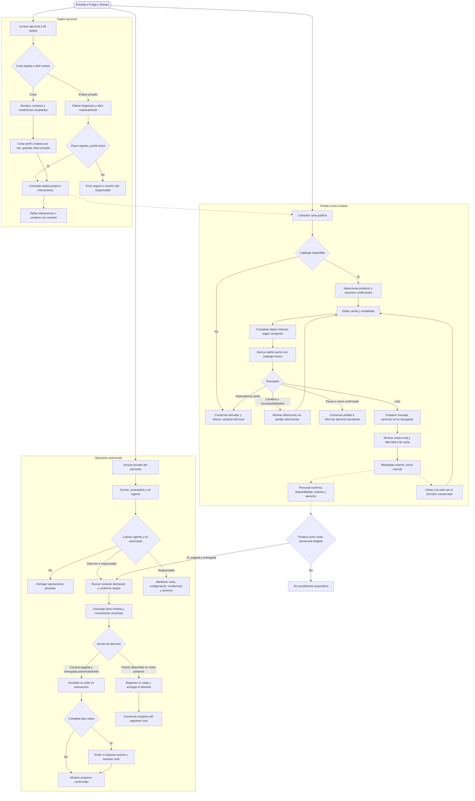
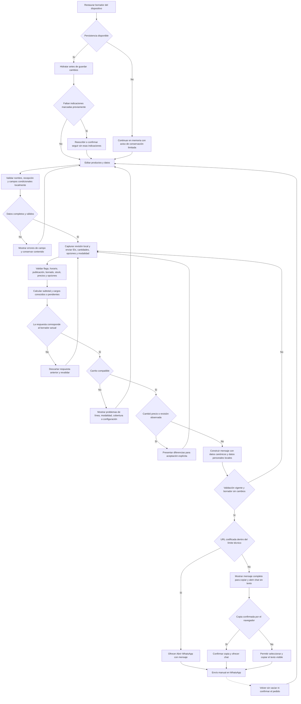
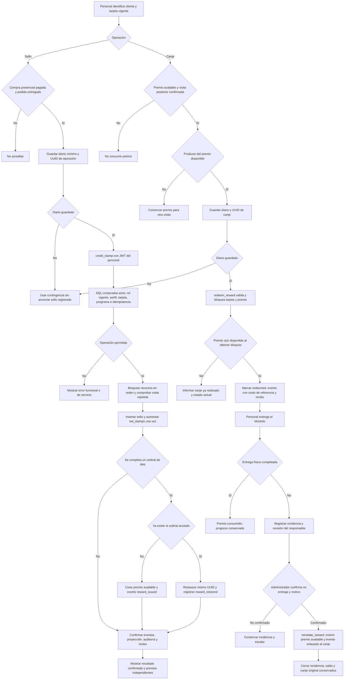
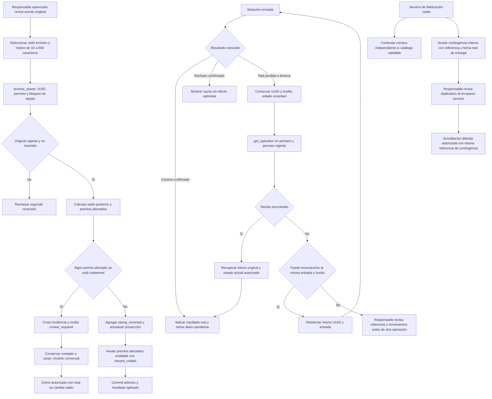
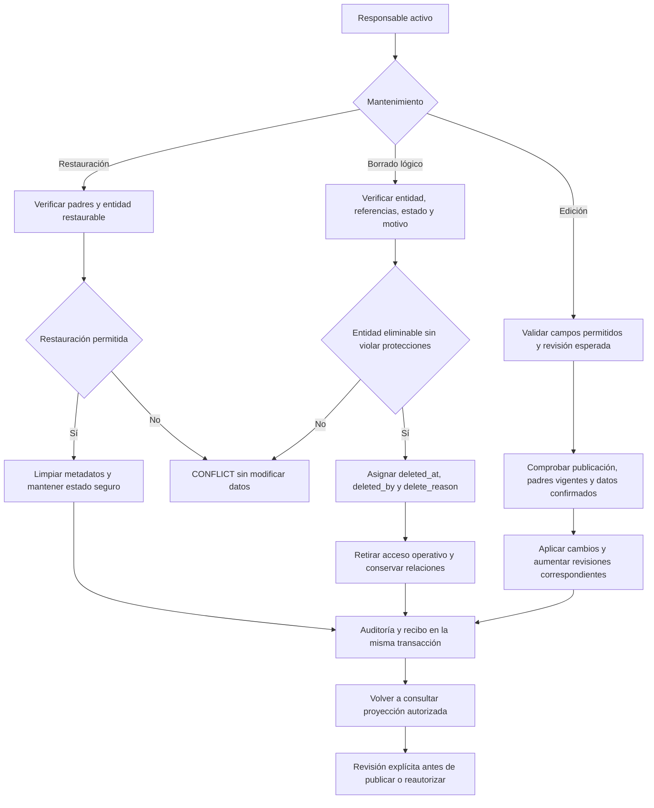

# 11. Diagramas de flujo de la aplicación

**Actualización DC-22, 13/10/2026:** [personal sin MFA](19-acceso-del-personal-sin-mfa.md) sustituye los requisitos de segundo factor, enrolamiento y AAL2 de este documento. Acceso con correo/contraseña, cuenta activa y rol vigente; cliente sin SMS. Evidencia histórica conserva las reglas comprobadas en su fecha.

**Actualización del 10/10/2026:** el acceso del cliente es por enlace privado/QR, sin SMS; nombre y teléfono son datos declarados. [Diseño vigente](16-acceso-a-tarjeta-sin-sms.md) sustituye las menciones anteriores a OTP, identidad telefónica Auth y `phone_change` del cliente. El acceso actual del personal se define en DC-22.

**Versión:** 1.0 · **Fecha:** 3 de octubre de 2026.  
**Estado:** flujos vigentes; implementación y comprobaciones en [H7](../implementacion/evidencia/h7/README.md). La evidencia distingue aprobación técnica de revisión humana/piloto.  
**Base:** [Análisis](../analisis-del-proyecto.md), [Fidelización](02-fidelizacion.md), [Contratos](05-contratos-y-operaciones.md) y [Tablas/soft delete](10-tablas-db.md).  
**Complementos:** [Navegación](12-flujo-navegacion.md), [Carpetas](13-estructura-carpetas.md).

## 1. Lectura de los diagramas

Los rectángulos representan acciones y los rombos decisiones. Los subgrupos señalan responsabilidades; las flechas discontinuas indican continuidad opcional, recuperación o trabajo manual fuera de la web. Son flujos de comportamiento: las URLs se detallan en el [documento de navegación](12-flujo-navegacion.md).

Hay tres recorridos independientes: pedido como invitado, tarjeta opcional del cliente y operación privada del personal. Autenticarse no es requisito para comprar. Un fallo de fidelización permite seguir el pedido si el catálogo puede validarse; una caída de la base que impide validar precios permite conservar el borrador y contactar al local, sin presentar una cotización vigente.

## 2. Flujo general

La coordinación por WhatsApp es externa. La web no observa si el visitante envió el mensaje, pagó o recibió el pedido; abrir el enlace no genera orden, sello ni estado de venta confirmada. La compra iniciada allí solo puede originar sello si termina como visita presencial elegible confirmada por el personal.

## 3. Preparación, revisión y recuperación del pedido

Reglas del contrato: validación dura como máximo 60 segundos, con plazo monotónico desde el inicio de la petición; edición/recarga obliga a revalidar. El límite técnico de URL codificada es 7.000 caracteres; superar el límite no trunca artículos. Nombre, dirección, referencias y observaciones no viajan a Supabase para validar el carrito.

Persistencia: `localStorage` conserva artículos/opciones/cantidades/modalidad y marcador sin texto de indicaciones; `sessionStorage` conserva datos personales e indicaciones por línea. La falta de una indicación requiere revisión y evita fusionar líneas silenciosamente. Costos desconocidos y total final son pendientes, nunca cero inventado. Se muestran solo medios de pago confirmados; recojo requiere ubicación confirmada.

Un producto/opción/precio eliminado o con padre eliminado invalida la línea. No se reemplaza por otro. P05 es incompatible con recojo; retirar la leyenda no cambia esa restricción. Catálogo agotado o fuera de vigencia, negocio cerrado y programa pausado son estados distintos.

## 4. Sello, premio y canje

El décimo sello deja progreso 0/10 y un premio disponible; el undécimo, 1/10 conservando ese premio. Veinte sellos originan dos premios. El canje no reduce `net_stamps`, no reinicia el ciclo y no suma sello por sí mismo. Una compra adicional elegible en la visita del canje tiene otra operación explícita.

Solo cuentan visitas reales distintas, aunque sean el mismo día; varios platos en una visita no multiplican sellos. UUID evita repetir una petición, pero no demuestra que dos UUID representen visitas distintas. Personal revisa últimos movimientos y referencia de visita, cuando existe.

Versiones retiradas conservan la regla de sus tarjetas. Pausa del programa bloquea nuevas altas/sellos/canjes y conserva consulta de progreso. Perfil/tarjeta eliminados no se reactivan al login; personal eliminado no opera con su JWT anterior. Un premio voided oculto sigue existiendo para restaurar su ordinal con el mismo UUID.

El diagrama mantiene el orden de canje acordado: confirmar registro digital y después entregar físicamente. DC-13 resuelve PT-13 con restitución supervisada por administrador, motivo y evento inmutable; no introduce transacción entre cocina y base ni restitución automática. Dos resoluciones concurrentes solo restituyen una vez.

## 5. Correcciones, reintentos y caídas

`not_found` significa que no se ve un recibo confirmado en esa lectura; la petición original aún podría estar en curso. Nunca permite sustituir el UUID. Un replay comprueba permiso actual: no habilita operaciones a personal eliminado o degradado. Tras recarga se revisa el diario antes de permitir otra acreditación/canje sobre esa tarjeta; no se guardan motivos libres o PII solo para automatizar reintentos.

Correcciones agregan hechos y conservan originales. Borrado lógico no corrige sellos ni canjes. Incidencias abiertas no se ocultan; versiones utilizadas y premios redeemed/available están protegidos. Cancelación anterior a entrega no origina sello; devolución posterior se revisa como incidencia, sin inventar política comercial.

## 6. Mantenimiento y conservación

Premios tienen una restauración especial dentro de la acreditación; no pasan por el botón genérico del diagrama. Staff eliminado queda inactivo; cliente/tarjeta, cerrados; catálogo vuelve a borrador/deshabilitado. Eventos, recibos, auditoría y singleton no pasan por eliminación. Los detalles de restricciones y bloqueos están en [Tablas DB](10-tablas-db.md).

## 7. Comprobaciones previstas

| Recorrido | Resultado verificable |
| --- | --- |
| Invitado y Auth caído | Continúa hasta WhatsApp si se puede validar catálogo. |
| Cambio comercial/borrado durante selección | Revisión explícita sin pérdida del borrador. |
| Regreso, recarga y URL larga | Borrador conservado, revalidación y mensaje completo. |
| Novena, décima y undécima visita | 9/10, premio con 0/10, luego 1/10 conservando premio. |
| Dos acreditaciones reales concurrentes | Ambas se suman; misma operación repetida aplica una vez. |
| Dos canjes sobre un premio | Un solo canje confirmado. |
| Agotamiento o falta de visita posterior | Premio permanece available. |
| Reversión con premio canjeado | review_required y saldo sin cambios. |
| Soft delete y restauración | Acceso/selección bloqueados, historia y UUID preservados. |
| Entrega física fallida después de canje | Incidencia y restitución supervisada DC-13 tras confirmar no entrega; mismo premio/saldo, original conservado. |

Se enlazan con [Pruebas y aceptación](08-pruebas-y-aceptacion.md). Son criterios de diseño; no se afirma haber probado todavía estos comportamientos en una aplicación.
