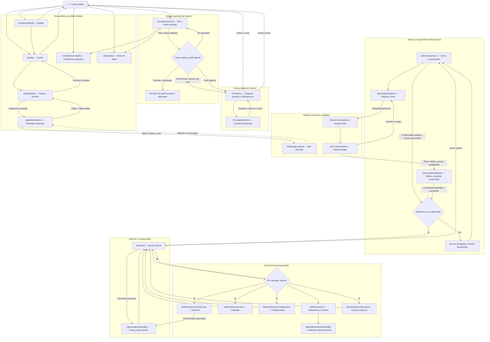
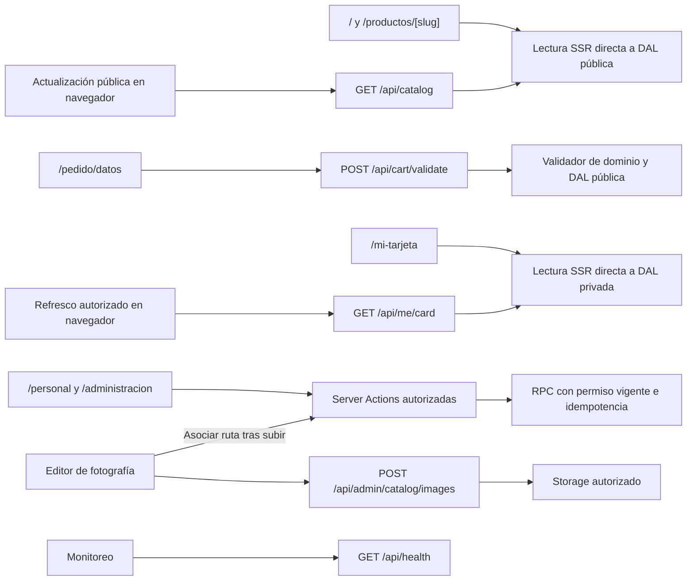

# 12. Flujo de navegación, páginas y rutas

**Actualización DC-22, 13/10/2026:** [personal sin MFA](19-acceso-del-personal-sin-mfa.md) sustituye los requisitos de segundo factor, enrolamiento y AAL2 de este documento. Acceso con correo/contraseña, cuenta activa y rol vigente; cliente sin SMS. Evidencia histórica conserva las reglas comprobadas en su fecha.

**Actualización del 10/10/2026:** el acceso del cliente es por enlace privado/QR, sin SMS; nombre y teléfono son datos declarados. [Diseño vigente](16-acceso-a-tarjeta-sin-sms.md) sustituye las menciones anteriores a OTP, identidad telefónica Auth y `phone_change` del cliente. El acceso actual del personal se define en DC-22.

**Versión:** 1.0 · **Fecha:** 3 de octubre de 2026.  
**Estado:** mapa objetivo del producto; las seis páginas y callback de H2 están implementadas según su [evidencia](../implementacion/evidencia/h2/README.md). Otras rutas siguen pendientes.  
**Base:** [Frontend](06-frontend-y-estado.md), [Seguridad](04-autenticacion-seguridad.md), [Contratos](05-contratos-y-operaciones.md) y [Soft delete](10-tablas-db.md).  
**Complementos:** [Flujo funcional](11-diagrama-flujo.md), [Estructura de carpetas](13-estructura-carpetas.md).

## 1. Criterio de navegación

DC-12 añade `/administracion` y `/administracion/clientes/[id]` a las veinte páginas y callback de Auth del diseño anterior. Diálogos de opciones, confirmación de sello y canje son componentes dentro de sus páginas. Los endpoints de API son interfaces HTTP, no pantallas.

Los grupos de rutas de Next.js no forman parte de la URL. Acceso de cliente/personal se ubica fuera de layouts que exijan una sesión completa. Layout, DAL, action, handler y RPC verifican lo que corresponde a cada operación; ver una pantalla o conocer un UUID no concede permisos.

## 2. Mermaid de páginas y navegación

La entrada normal del público no muestra el panel interno como parte del pedido. Personal accede por su URL conocida. Una sesión staff ya autorizada puede ir directamente a `/personal`; no necesita repetir MFA en cada navegación. Una identidad puede tener perfil cliente y autorización staff de forma independiente.

## 3. Inventario de páginas

| Ruta | Grupo futuro | Acceso | Entrada, salida y estados |
| --- | --- | --- | --- |
| `/` | `(public)` | Público | Carta SSR; enlaza detalle, carrito y tarjeta. Sin cookies de sesión en layout público. |
| `/productos/[slug]` | `(public)` | Público | Detalle publicable; borrado/no publicable = not-found, agotado visible sin agregado. |
| `/pedido` | `(public)` | Público | Editar borrador; vacío enlaza carta; conserva datos al retroceder. |
| `/pedido/datos` | `(public)` | Público | Datos condicionales y validación; sin líneas válidas vuelve a carrito. |
| `/pedido/continuar` | `(public)` | Público | Abrir/copiar mensaje; sin resultado vigente revalida o vuelve a datos; no confirma venta. |
| `/condiciones-tarjeta` | `(public)` | Público | Condiciones versionadas, accesibles antes del alta. |
| `/privacidad` | `(public)` | Público | Aviso aprobado antes de recopilar datos; no inventa cumplimiento legal. |
| `/mi-tarjeta/acceso` | `(customer-access)` | Público y cliente en alta | Nombre/contacto/términos o enlace privado; sin SMS; si ya existe acceso vigente, ofrece volver a la tarjeta; un enlace distinto exige apertura expresa. Perfil cerrado requiere revisión. |
| `/mi-tarjeta` | `(customer)` | Cliente con clave privada válida | Propia tarjeta/indicaciones; sin perfil conduce a activación. Suspendida se consulta con estado; closed/deleted requiere revisión. |
| `/mi-tarjeta/telefono` | `(customer)` | Cliente identificado propio | Cambiar contacto con clave propia y revisión; mismos UUID. Pérdida de acceso/enlace requiere PT-08/H7. |
| `/personal/acceso` | `(staff-access)` | Público | Login interno; sin fila staff vigente no entra. Cuenta autorizada va directamente a personal. |
| `/personal/mfa` | `(staff-access)` | Alias antiguo | Redirige a `/personal`, que aplica autenticación y autorización actual. Sin enrolamiento ni desafío. |
| `/personal/recuperar` | `(staff-access)` | Público | Solicitud genérica de correo, límites de Auth y sin CAPTCHA por DC-20; sin revelar cuentas existentes. |
| `/personal/restablecer` | `(staff-access)` | Identidad validada por callback, permiso firmado vigente y staff autorizado | Definir contraseña con permiso temporal firmado; no asigna rol ni exige segundo factor. |
| `/personal` | `(staff)` | Atención/manager activos | Búsqueda exacta de contacto declarado y confirmación de tarjeta; diferencia ausencia y servicio caído. |
| `/personal/clientes/[id]` | `(staff)` | Atención/manager activos | Ficha mínima/sello/canje; corrección e historial amplio solo manager. ID no concede acceso. |
| `/administracion/carta` | `(admin)` | Manager activo | Edición y conservación comercial; conflictos de revisión no sobrescriben. |
| `/administracion` | `(admin)` | Manager activo | Indicadores, periodo y listado paginado con filtros de progreso/premios. |
| `/administracion/clientes/[id]` | `(admin)` | Manager activo | Historial, corrección/reversión, recuperación presencial y conciliación de contingencia. |
| `/administracion/configuracion` | `(admin)` | Manager activo | Datos verificados, flags y premio/costo; sin editor de metas/campañas. |
| `/administracion/incidencias` | `(admin)` | Manager activo | Revisar/cerrar; no ocultar abiertas ni implementar restitución pendiente PT-13. |
| `/administracion/personal` | `(admin)` | Manager activo | Invitaciones/roles/baja/restauración; último manager protegido. |

DC-12 admite listado privado paginado del responsable, sin exportación masiva ni página pública de recuperación. DC-14 aprueba recuperación presencial con comprobante/historial; DC-15 excluye baja de clientes/tarjetas. [Reglas vigentes](17-administracion-y-operacion-h7.md).

## 4. Route Handlers y APIs: interfaces, no páginas

| Método/ruta | Consumidor | Efecto y protección |
| --- | --- | --- |
| `GET /auth/confirm` | Enlace de correo Auth | Verificar token_hash de tipo invite/recovery; sesión SSR y destino fijo `/personal/restablecer`. Sin query sensible en logs/analítica. |
| `GET /api/catalog` | Navegador público | Proyección `read_catalog`; no sesión, no-store y filtros de borrado/padres. |
| `POST /api/cart/validate` | Checkout invitado | Valida IDs/precios/opciones y devuelve datos canónicos, sin guardar solicitud. |
| `GET /api/me/card` | Cliente identificado | Propia tarjeta; identidad de sesión, nunca userId arbitrario. |
| `POST /api/admin/catalog/images` | Editor manager | Subida validada con JWT manager activo; asociación posterior por action. |
| `GET /api/health` | Operación/monitoreo | Salud mínima sin secretos, PII ni detalles SQL; no es dashboard ni catálogo. |

Los Server Components llaman directamente a la DAL, sin HTTP contra los handlers de la propia aplicación. Mutaciones del panel/identidad usan Server Actions compartiendo validadores y servicios; no se agregan endpoints CRUD por tabla. La API de tarjeta existe para refresco del navegador, sin permitir consultar tarjetas ajenas.

## 5. Guards, redirecciones y errores

| Situación | Comportamiento |
| --- | --- |
| Cliente sin sesión entra a ruta privada | Ir a `/mi-tarjeta/acceso`; conservar productos del carrito. |
| Cliente nuevo sin tarjeta | Activación dentro de acceso; no autoemitir sello. |
| Perfil closed/deleted o identidad incoherente | Estado de revisión, sin reactivar ni mostrar otra tarjeta. |
| Staff sin sesión | Ir a `/personal/acceso`. |
| Staff vigente con AAL1 | Ir a `/personal/mfa`; la ruta MFA no usa layout que ya exija AAL2. |
| Staff inactivo/eliminado con JWT vigente | Denegar panel/actions/RPC; login no restaura autorización. |
| Atención entra a administración | Denegar acción y presentar salida a `/personal`, sin datos administrativos. |
| ID privado desconocido/no accesible | Error equivalente de recurso no disponible, sin información de otra entidad. |
| Error funcional de formulario | Mostrar en la vista, conservar datos; no enviar a página genérica de excepción. |
| Error inesperado | Error boundary con reintento; no imprimir datos SQL/secretos. |
| Callback vencido/usado | Estado seguro y salida a recuperación/login; no token sensible retenido en URL propia. |
| Cierre de sesión | Limpiar vistas/datos privados y formulario sensible; renovar navegación. Conservar artículos, revisar indicaciones perdidas. |

No aceptar destinos libres `next`/`redirect_to`. La recuperación de pedido se basa en almacenamiento local y enlaces internos conocidos; los callbacks usan destinos fijos configurados. El proxy renueva sesiones de áreas privadas y sus APIs, pero la autorización definitiva ocurre nuevamente en servicios/RPC.

Cada grupo tiene un layout propio bajo un único root layout. El público no exige sesión; `(customer-access)` no hereda `(customer)`; `(staff-access)` no hereda `(staff)` ni `(admin)`. Evitar duplicar la misma URL entre grupos: solo una `page.tsx` por ruta.

## 6. Conservación de estado y acceso directo

No confiar en la historia del navegador para justificar acceso. Un enlace directo a datos/continuación sin carrito muestra recuperación hacia carrito/carta. Una recarga de continuación reconstruye y revalida; nunca utiliza como cotización un mensaje antiguo guardado en una URL propia.

Abrir WhatsApp mantiene el borrador. Al volver se permite editar/reabrir, y «Nuevo pedido» limpia solo tras confirmación. No se incorpora ruta `/pedido/exito` porque no existe confirmación de venta.

Cliente y staff no comparten stores de perfiles. Una nueva identidad no recupera datos o resultados privados de la sesión anterior. Sesiones y respuestas privadas usan no-store; cerrar sesión también limpia memoria del router/cliente. Preferencias habituales se usan solo tras elección explícita del cliente.

## 7. Comprobaciones previstas

Revisar que las 20 páginas aparezcan tanto en el Mermaid como en el árbol de carpetas. Probar entrada directa sin sesión, AAL1 hacia MFA, sesión eliminada, rol insuficiente, callback inválido y teléfono cambiado. Verificar que acceso/permisos/recuperación no entren en bucles por sus layouts y que APIs/Server Actions no dependan de haber abierto previamente una página.

La navegación pública debe funcionar sin Auth y permitir retorno desde WhatsApp. Las páginas privadas usan noindex; SEO público se restringe a información confirmada. Estos recorridos se implementarán y probarán según [Pruebas](08-pruebas-y-aceptacion.md); la presente revisión comprueba documentación y no acredita una aplicación operativa.
