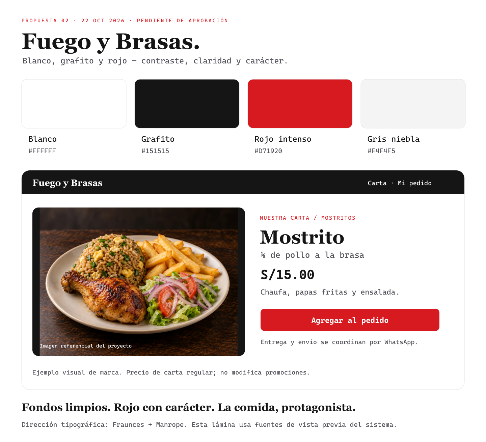

# Colores observados en pollerías — revisión del 22/10/2026

**Aprobación del 24/10:** la propuesta 06 fue aprobada; ver [aplicación DC-28](../diseno-tecnico/23-renovacion-ux-ui-y-marca.md) y el sistema visual canónico. Los estados de revisión fechados del 22/10 de abajo se conservan como historial.

**Revisión de propuesta:** las recomendaciones 01–04 no fueron aprobadas. El amarillo de la propuesta 05 fue aceptado, pero su rojo requiere oscurecerse. La candidata actual es la [propuesta 06: rojo profundo y amarillo vivo](manual-propuesto-06-rojo-profundo.md), con encabezado rojo y letras blancas; incluye comprobación adicional de estilos públicos y fuentes. La propuesta 02 de abajo queda como antecedente de la investigación, no como instrucción vigente de implementación.

El propietario descartó la propuesta «Brasa cálida» y pidió comprobar qué colores predominan en otras pollerías. No se aplica esa propuesta a la web. Esta revisión observa los sitios oficiales en Chrome; describe su apariencia, no un manual oficial ni una medición de preferencia de todos los restaurantes.

| Referente | Base de interfaz observada | Color de marca / acción | Observaciones |
| --- | --- | --- | --- |
| [Pardos Chicken](https://www.pardoschicken.pe/) | Blanco, texto negro, logo blanco/negro | Rojo intenso | Navegación clara y acciones rojas. Las campañas pueden introducir otros tonos. |
| [Don Belisario](https://www.donbelisario.com.pe/menu) | Blanco y negro | Rojo vivo | Botones, promociones y selección de categorías rojos; fotos grandes. |
| [Norkys](https://norkys.pe/) | Blanco y encabezado verde | Verde y naranja | El verde identifica la marca; el naranja acompaña campañas y acceso a ubicación. |
| [Roky’s](https://rokys.com/) | Blanco y texto negro | Verde y amarillo | El verde/amarillo aparece en marca y controles; la campaña observada añade negro y violeta. |
| [La Leña](https://www.lalena.com.pe/) | Negro y crema | Rojo | Fotografía amplia, encabezado negro y acciones rojas. |

## Qué se repite en esta muestra

Fondos blancos/neutros, tipografía negra/oscura y un color de marca reconocible. El rojo aparece en Pardos, Don Belisario y La Leña; verde en Norkys y Roky’s. Amarillo/naranja funcionan como apoyo en las marcas que los usan. No existe una única paleta obligatoria para una pollería; tampoco se concluye que un color incremente ventas a partir de esta observación.

Se distingue interfaz estable de campañas temporales: no adoptar violeta, naranja u otros colores de un banner como si fueran toda la identidad. La comida aporta sus colores naturales; botones y navegación no necesitan competir con ella.

## Recomendación para Fuego y Brasas

**Blanco + grafito + rojo intenso**, sin fondos crema, marrones o dorados de interfaz. El sello original conserva sus colores dentro del recurso; no se recolorea ni se sustituye sin permiso. El resultado buscado es más nítido, enérgico y contemporáneo.

Paleta propuesta, no extraída como códigos oficiales de competidores:

| Rol | HEX |
| --- | --- |
| Fondo / superficie | `#FFFFFF` |
| Grafito / texto principal | `#151515` |
| Rojo principal | `#D71920` |
| Rojo hover | `#B5141B` |
| Superficie secundaria | `#F4F4F5` |
| Texto secundario | `#52525B` |
| Separadores | `#E4E4E7` |

Rojo para una acción principal por bloque y selección activa; grafito para títulos/encabezado; blanco y gris muy claro para lectura. Tipografía Fraunces/Manrope conservada y fotografías amplias, sin aumentar colores decorativos. La lámina es una aproximación con fuentes de vista previa del sistema, no una pantalla desplegada.

**Estado de propuesta 02:** no aprobada; sustituida como candidata por la propuesta 06 enlazada al inicio. La aplicación mantiene sus tokens vigentes hasta aprobar la nueva dirección. El [manual anterior](propuesta-manual-de-marca.md) está marcado como descartado y no es una guía productiva.

UI/UX Pro Max se utilizó como apoyo para contraste, etiquetas e imágenes. La observación de las marcas y la decisión del propietario prevalecen sobre su recomendación genérica de colores cálidos.
