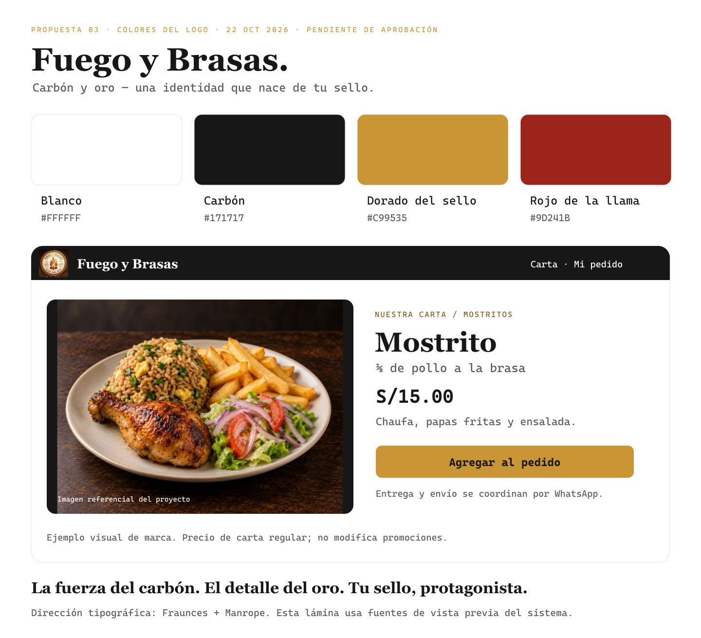

# Fuego y Brasas — Propuesta 03: Carbón y oro

**Fecha:** 22/10/2026. **Estado:** revisada, sin aprobación. El propietario pidió aclarar el uso del rojo y revisar el encabezado negro; la candidata actual es la [propuesta 04](manual-propuesto-04-blanco-oro-rojo.md). La propuesta 01 cálida fue descartada; la 02 blanca/roja no fue aprobada. Este documento se conserva como historial y no sustituye los tokens de producción.

## Concepto y referencia

La identidad nace del sello circular: aro dorado, texto oscuro y llama roja/naranja. **Blanco como fondo, carbón para texto y bloques de marca, dorado como acción principal y rojo como acento pequeño.** El crema interno del sello no se extiende al fondo de la web.

Referencias: los dos recortes del logo enviados por el propietario y el [Facebook indicado](https://www.facebook.com/p/Fuego-y-Brasas-61585453973558/). La consulta web de Facebook no devolvió contenido utilizable y el navegador no completó la captura; no se atribuye revisión de publicaciones inaccesibles. Los HEX son una adaptación de interfaz a los recortes, no valores certificados de un manual original.

## Paleta

| Rol | HEX | Aplicación |
| --- | --- | --- |
| Blanco | `#FFFFFF` | Fondo y superficies de lectura. |
| Carbón neutro | `#171717` | Texto, encabezado y cierre. |
| Dorado del sello | `#C99535` | Acción principal, detalles y selección. |
| Rojo de la llama | `#9D241B` | Promoción o énfasis breve. |
| Naranja de fuego | `#E56A16` | Logo y decoración mínima; no otro botón principal. |

Apoyos: hover dorado `#B88427`; dorado oscuro para enlaces `#805A19`; texto secundario `#5C5C5C`; separadores `#E5E5E5`; controles `#808080`; superficie secundaria `#F5F5F5`. Distribución orientativa: 75 % blanco/gris, 20 % carbón y 5 % acentos. Las fotos conservan sus colores naturales.

## Legibilidad

| Par | Contraste sRGB |
| --- | --- |
| Carbón / blanco | 17,93:1 |
| Texto secundario / blanco | 6,69:1 |
| Carbón / botón dorado | 6,69:1 |
| Dorado oscuro / blanco | 6,19:1 |
| Rojo de llama / blanco | 7,77:1 |
| Contorno de control / blanco | 3,95:1 |

El botón principal es **dorado con texto carbón**; el blanco normal no corresponde sobre ese dorado. Enlaces sobre blanco: dorado oscuro o carbón subrayado. Foco de 2 px separado 2 px, con contraste comprobado sobre cada fondo. Estos cálculos no certifican pantallas; errores y estados llevan texto/icono.

## Logotipo y tipografía

Conservar el sello, su llama, letras y colores. No redibujar, recolorear, estirar ni generar una variante nueva. La lámina incorpora el recorte recibido sin modificar sus píxeles. El original de mayor resolución/vector sigue siendo necesario para usos grandes; un sello pequeño debe acompañarse con el nombre legible. Margen libre: un cuarto del diámetro.

Conservar **Fraunces 600–700** en títulos breves y **Manrope 400–700** en productos, precios, botones y lectura. Ya están alojadas localmente con licencia. Texto 16/24 px, apoyo 14/20, productos 18/26, títulos 32/38 móvil y 48/56 escritorio; importes con cifras tabulares. La lámina usa fuentes del sistema como aproximación y lo indica al pie.

## Fotografía y composición

Fotografía amplia, plato completo, luz natural y acompañamientos visibles. Primero fotos propias; las imágenes de apoyo existentes se identifican como referenciales. No copiar recursos de competidores ni usar una imagen como prueba de la porción. Caja 4:3 con espacio reservado; evitar recortes que oculten inclusiones, saturación naranja y humo/llamas sobre texto.

Carta con categorías claras, nombre/porción, inclusiones, precio y acción. Detalle con foto grande y un bloque compacto de cantidad/opciones/indicaciones. Pedido de platos y subtotal; entrega y costo de envío se coordinan por WhatsApp. Sin selector de modalidad ni dirección requerida en la web.

Tarjetas 12 px, campos 8 px y botones 10 px; espacios en escala 4/8 px; ancho 1200 px. Controles de al menos 48 × 48 px, foco visible, etiquetas persistentes, carga contextual para operaciones asíncronas y movimiento reducido. Revisar 320, 360, 390, 768 y 1280 px. Paneles y tarjeta comparten identidad sin modificar reglas comerciales.

Voz cercana y concreta: «Elige tu antojo», «Agregar al pedido», «Coordinamos por WhatsApp». Conservar «Sabor que une, momentos que quedan». Evitar popularidad, descuentos, ingredientes o confirmaciones de venta inventadas.

## Aprobación y aplicación

La [comparativa de pollerías](comparativa-colores-pollerias.md) aporta estructura y claridad; los colores de esta propuesta proceden del sello propio. UI/UX Pro Max apoya legibilidad, feedback e imágenes, sin imponer otra paleta.

Se solicita aprobar **blanco + carbón + dorado del sello**, con rojo de llama discreto y el logo conservado. Con aprobación: actualizar `.agents/brand/sistema-visual.md`, Tailwind y el color de texto sobre acción para botones dorados; revisar componentes compartidos, formularios, fidelización y paneles. Hasta entonces, esta carpeta es material de propuesta.

Archivos: [PNG](propuesta-03-carbon-y-oro.png), [SVG](propuesta-03-carbon-y-oro.svg) y [datos/contraste](propuesta-03-carbon-y-oro.json).
