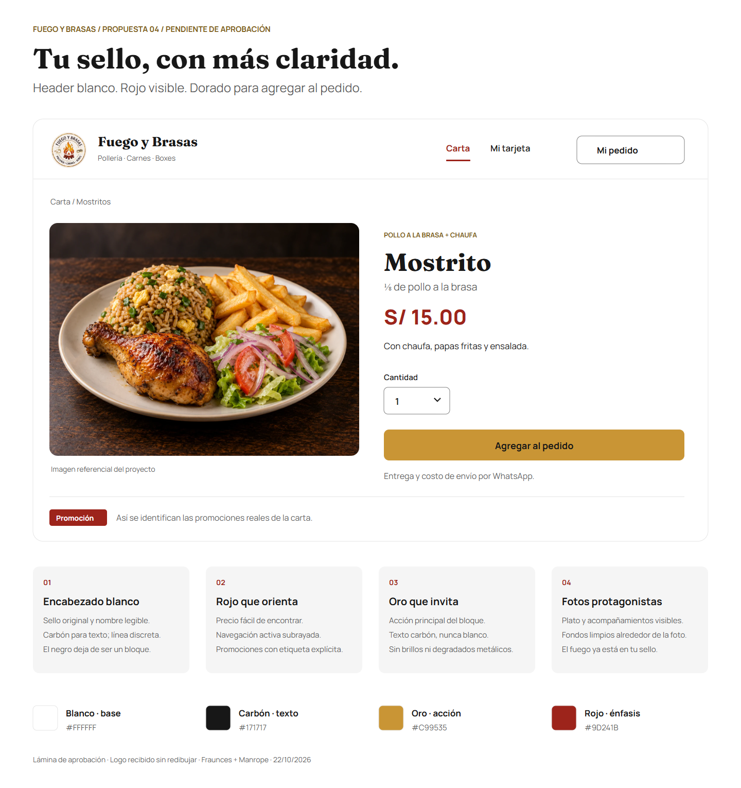

# Fuego y Brasas — Propuesta 04: blanco, oro y rojo de llama

**Fecha:** 22/10/2026. **Estado:** revisada, sin aprobación. El propietario pidió probar header rojo con letras blancas y amarillo más llamativo; la candidata actual es la [propuesta 05](manual-propuesto-05-rojo-amarillo.md). Esta revisión se conserva como historial y no cambia los tokens de la aplicación.

## Dirección de marca

La identidad mantiene el sello circular, el dorado del aro, el texto oscuro y la llama roja/naranja. La interfaz propone **blanco como base, carbón como texto, oro como acción y rojo como énfasis comercial**. Las fotografías aportan el resto del color. El crema se conserva dentro del sello; el naranja permanece en el logo, sin convertirse en otro color de botones.

La revisión es una recomendación de diseño para esta marca, no una regla deducida de que un competidor use un color. No se atribuyen efectos sobre apetito, ventas o conversiones a la paleta. La [investigación de pollerías](comparativa-colores-pollerias.md) aporta referencias de estructura y legibilidad.

## Encabezado y superficies

- Encabezado **blanco**, con sello y nombre legible a la izquierda, navegación breve y acceso al pedido. Separador fino; sin franja negra, degradado dorado o llamas de fondo.
- Texto de navegación carbón. Página actual en rojo con subrayado y, al implementar, `aria-current="page"`; su estado no depende solo del color.
- «Mi pedido» como acceso secundario con contorno. El botón de agregar conserva la prioridad en la ficha del producto.
- Fondo blanco en carta y detalle. Gris muy claro para apoyos puntuales y separadores discretos. Pie de página blanco o gris claro, con texto carbón.
- El carbón sigue presente en títulos, iconos, lectura y fotografía. No se convierte en un gran fondo de marca por defecto.

El sello de la lámina es el recorte claro recibido del propietario, mostrado con máscara circular que oculta el anuncio alrededor; no se reconstruyen letras ni se cambian sus colores. Para producción y piezas grandes falta un original de calidad con fondo transparente. Los archivos originales recibidos se conservan sin alterar.

## Dónde se usa cada color

| Elemento | Propuesta | Regla de uso |
| --- | --- | --- |
| Precio del plato y subtotal de productos | Rojo de llama | Mantener «S/», importe y etiqueta de subtotal; el color refuerza su ubicación. No implica descuento. |
| Navegación o categoría activa | Rojo de llama | Subrayado o indicador visible, además de semántica de selección. |
| Etiqueta «Promoción» | Rojo de llama con texto blanco | Solo en artículos que realmente sean promociones; no inventar rebajas, urgencia o popularidad. |
| «Agregar al pedido» o acción principal del bloque | Dorado con texto carbón | Un foco principal por bloque. Sin texto blanco sobre dorado, brillo ni degradado metálico. |
| Nombre del negocio, títulos, cuerpo e iconos | Carbón | Jerarquía por tamaño/peso y espacio. No pintar títulos enteros de dorado. |
| Fondo, header y superficies | Blanco | Proporcionar espacio alrededor del sello, comida y controles. |
| Apoyos secundarios | Gris neutro claro | Separar contenido, sin sustituir el límite legible de campos. |
| Naranja | El existente en el sello | No añadir un segundo color promocional o de acción. |

La etiqueta «Promoción» bajo el ejemplo de producto es **una muestra del componente**. No declara que el Mostrito regular de S/ 15.00 mostrado sea una promoción. La lámina mantiene el precio regular aportado; no modifica la carta.

Errores, éxito e información mantienen sus funciones semánticas y mensajes explícitos. Un precio rojo no es un error: un error se identifica con texto, ubicación y, cuando corresponde, icono. Las acciones destructivas no reutilizan el estilo del botón dorado de compra.

## Paleta candidata y contraste

Estos valores son adaptaciones de interfaz a los recortes del logo, **no códigos oficiales extraídos de un manual**. Hasta su aprobación, solo son candidatos de esta propuesta.

| Rol | HEX |
| --- | --- |
| Fondo / superficie | `#FFFFFF` |
| Texto principal | `#171717` |
| Texto secundario | `#5C5C5C` |
| Acción principal / hover | `#C99535` / `#B88427` |
| Texto sobre acción | `#171717` |
| Rojo de llama | `#9D241B` |
| Dorado oscuro de apoyo | `#805A19` |
| Naranja, limitado al recurso de marca | `#E56A16` |
| Superficie secundaria | `#F5F5F5` |
| Separador decorativo / contorno de control | `#E5E5E5` / `#808080` |

Contraste sRGB sobre colores sólidos: carbón/blanco **17,93:1**, secundario/blanco **6,69:1**, carbón/dorado **6,69:1**, rojo/blanco **7,77:1**, dorado oscuro/blanco **6,19:1** y contorno/blanco **3,95:1**. Son cálculos de la propuesta; no acreditan accesibilidad de pantallas implementadas. Foco visible con separación, contraste sobre el fondo adyacente y estado adicional al color.

Los tokens aprobados seguirán teniendo una sola fuente: [sistema visual canónico](../../.agents/brand/sistema-visual.md). Con aprobación, se trasladarán allí los valores y reglas aceptados; este documento quedará como historial, sin actuar como segunda configuración productiva.

## Tipografía, fotografía y experiencia

La lámina usa las fuentes locales reales del proyecto: **Fraunces 600–700** en títulos de marca y **Manrope 400–800** en interfaz y precios. La implementación mantendrá los pesos aprobados por el sistema canónico; texto base 16/24 px, productos 18/26 px, precios legibles y controles de al menos 48 × 48 CSS px. Fotografías grandes y contenedor con tamaño reservado; las fotos de apoyo se identifican como referenciales. No usar fotos de competidores ni inventar una porción a partir de una imagen.

La foto, nombre, porción, inclusiones y precio forman el primer bloque de lectura. Cantidad, opciones reales e indicaciones opcionales preceden a «Agregar al pedido». Entrega y costo de envío se coordinan por WhatsApp. No se vuelve a pedir modalidad, dirección o pago en la web. Sin carruseles automáticos, banners superpuestos o afirmaciones de venta confirmada.

En móvil: sello con nombre legible, acceso al pedido y navegación adaptable; foto y ficha en una columna. No comprimir toda la barra de escritorio ni ocultar el precio detrás de interacciones. Revisar 320, 360, 390, 768 y 1280 px, teclado, foco, reflujo, zoom y estados de carga/error cuando se implemente. La lámina es una propuesta estática, no evidencia de esas pruebas.

## Revisión y siguiente paso

Se volvió a consultar `ui-ux-pro-max`, dominio UX, «color hierarchy semantic contrast»: contraste mínimo y prohibición de comunicar estados solo mediante color. Su guía respalda legibilidad y estados; la distribución de rojo/oro y el header blanco es una recomendación propia basada en el logo y las observaciones del propietario. No se persistió otra plantilla de la skill.

Se solicita aprobación de esta distribución y de la lámina. Solo después se actualizarán sistema canónico, tema Tailwind y componentes, incorporando el color de texto sobre acción para evitar botones dorados con texto blanco. Se comprobarán carta, detalle, pedido, tarjeta y paneles con la misma identidad.

Recursos: [PNG](propuesta-04-blanco-oro-rojo.png), [SVG](propuesta-04-blanco-oro-rojo.svg) y [datos de la propuesta](propuesta-04-blanco-oro-rojo.json). La revisión sustituye la propuesta 03 como candidata actual; no representa un rediseño aprobado del logotipo.
