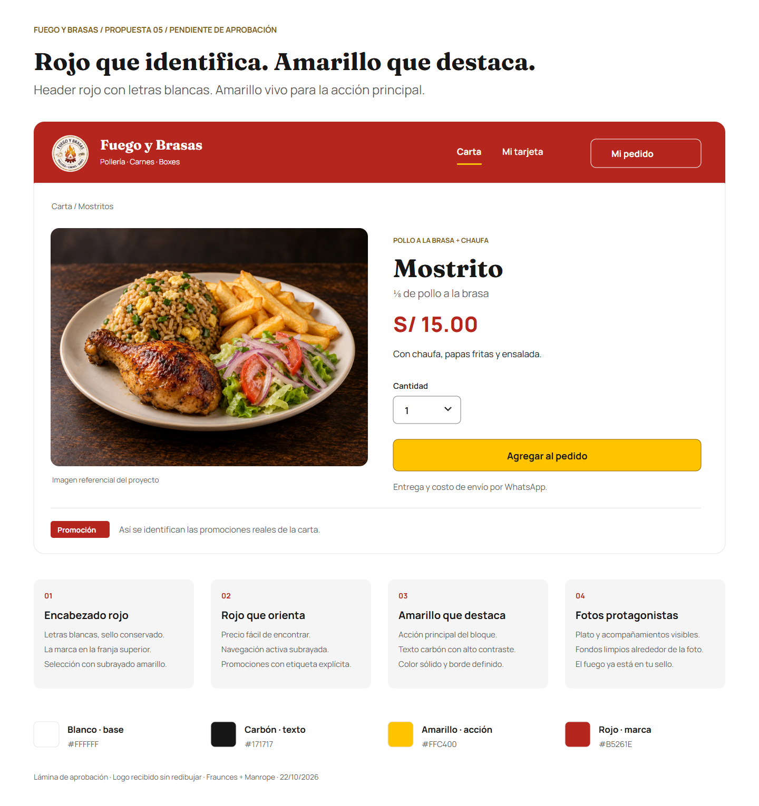

# Fuego y Brasas — Propuesta 05: rojo y amarillo vivo

**Fecha:** 22/10/2026. **Estado:** amarillo `#FFC400` aceptado; rojo por ajustar. El propietario pidió un rojo algo más oscuro y revisar referencias; la candidata actual es la [propuesta 06](manual-propuesto-06-rojo-profundo.md). Se conserva este documento como historial. Todavía no cambia la aplicación.

## Dirección

**Rojo de marca en el header, letras blancas y amarillo vivo en la acción principal.** El cuerpo conserva fondo blanco y texto carbón. El sello mantiene sus colores originales y las fotografías conservan protagonismo.

La referencia a [Norkys](https://norkys.pe/) se interpreta como presencia de un color reconocible y saturado, según la [revisión visual realizada](comparativa-colores-pollerias.md). No es una equivalencia de intensidad medida entre colores ni una copia de su identidad. El amarillo de interfaz es una adaptación más viva del oro/fuego del sello, sin recolorear el logotipo.

## Aplicación por elemento

| Elemento | Tratamiento propuesto |
| --- | --- |
| Encabezado | Fondo rojo sólido; nombre, navegación e iconos blancos. Sello legible con espacio alrededor. |
| Página activa en el header | Texto blanco más subrayado amarillo; implementar `aria-current` y foco visible. |
| Acceso «Mi pedido» en el header | Contorno y texto blancos sobre rojo; acceso secundario junto a la navegación. |
| Botón «Agregar al pedido» | Amarillo vivo, texto carbón y contorno definido. Una acción principal por bloque. |
| Precio y subtotal de productos | Rojo sobre blanco, con moneda e importe. El color no implica descuento. |
| Promociones reales | Etiqueta roja con texto blanco «Promoción», sin inventar urgencia, rebajas o popularidad. |
| Títulos, lectura e iconos del cuerpo | Carbón; apoyos en gris neutro. |
| Fondo de carta, detalle y formularios | Blanco; gris claro solo para apoyos puntuales. |

El amarillo se concentra en botones e indicadores; no se extiende a todas las tarjetas o textos. No usar letras blancas sobre amarillo. Los errores incluyen mensaje explícito y contexto para distinguirlos de un precio rojo; el estado nunca se transmite solo mediante color.

La etiqueta «Promoción» debajo del detalle en la lámina es una muestra de componente. **No convierte en promoción el Mostrito regular de S/ 15.00 mostrado.** Se conserva la carta; entrega y costo de envío se coordinan por WhatsApp.

## Paleta candidata

| Rol | Valor propuesto |
| --- | --- |
| Rojo de marca | `#B5261E` |
| Amarillo principal / hover | `#FFC400` / `#E6AD00` |
| Texto principal / sobre amarillo | `#171717` |
| Texto sobre rojo / fondo y superficies | `#FFFFFF` |
| Texto secundario | `#5C5C5C` |
| Contorno de acción amarilla | `#966000` |
| Superficie secundaria / separador | `#F5F5F5` / `#E5E5E5` |
| Contorno de campos | `#808080` |

Los HEX son candidatos de interfaz, no valores oficiales certificados. El rojo se ajusta respecto a la propuesta anterior para dar presencia al encabezado; el amarillo sustituye el dorado apagado de los botones. El oro y naranja propios del sello permanecen dentro del recurso original.

Contrastes sRGB de colores sólidos: blanco/rojo **6,44:1**, carbón/amarillo **11,22:1** y amarillo/rojo **4,03:1**. Blanco/amarillo da **1,60:1** y se descarta para texto. El contorno oscuro identifica el límite del botón sobre blanco y amarillo; los ratios completos quedan en los [datos de la propuesta](propuesta-05-rojo-amarillo.json). El foco sobre rojo será blanco, separado del control; sobre blanco, rojo. Comprobar los pares realmente renderizados al implementar; estos cálculos no certifican pantallas.

## Sello, fuentes y composición

La lámina muestra el recorte claro proporcionado con máscara circular para ocultar el anuncio alrededor. No se reconstruye ni recolorea el sello; el archivo original permanece intacto. Para producción y piezas grandes falta el original de buena resolución y fondo transparente.

Se mantienen **Fraunces** en títulos breves y **Manrope** en interfaz; la lámina usa las fuentes locales reales. Producto, porción, inclusiones y precio preceden a cantidad/opciones/indicaciones y al botón. Fotografías amplias, referenciales identificadas y espacios generosos. No añadir llamas detrás del texto, degradados metálicos ni carruseles automáticos.

La versión móvil reducirá el header a marca y acciones esenciales, con navegación adaptable y controles táctiles de al menos 48 × 48 CSS px. Foto y ficha en una columna; no comprimir la barra de escritorio. Conservar texto base 16/24 px y foco despejado. La futura aplicación requiere revisión en 320, 360, 390, 768 y 1280 px, teclado, zoom, errores y carga contextual. La lámina estática no demuestra esas pruebas.

## Aprobación y fuente de verdad

Se reutiliza la revisión de `ui-ux-pro-max` de esta etapa: contraste, color acompañado de indicadores/texto y jerarquía de interacción. El header rojo y amarillo vivo responden a la petición actual del propietario; no se atribuyen a una plantilla automática ni a una supuesta mejora de ventas.

Esta propuesta sustituye la 04 como candidata para aprobación. Después de aprobarla se actualizarán el [sistema visual canónico](../../.agents/brand/sistema-visual.md), el tema Tailwind y los componentes afectados, incluido el token de texto sobre acción. Los valores productivos seguirán definidos una sola vez en el sistema canónico; este documento quedará como historial de la propuesta.

Recursos: [lámina PNG](propuesta-05-rojo-amarillo.png), [SVG](propuesta-05-rojo-amarillo.svg) y [datos/contraste](propuesta-05-rojo-amarillo.json).
