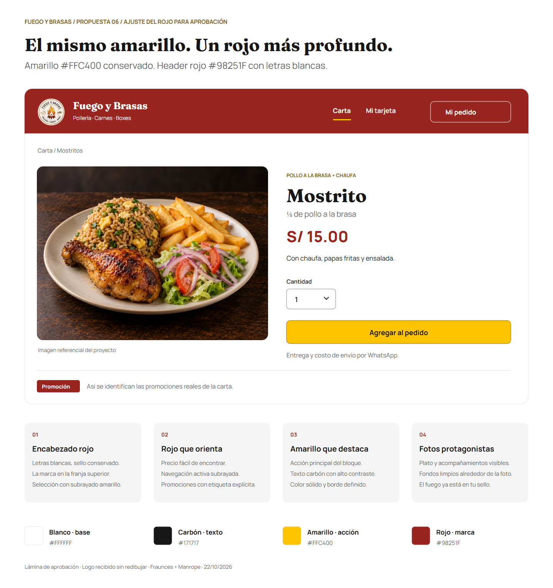

# Fuego y Brasas — Propuesta 06: rojo profundo y amarillo vivo

**Fecha de propuesta:** 22/10/2026. **Estado:** aprobada por el propietario el 24/10/2026: «excelente, mucho mejor, ahora sí puedes proseguir». [Aplicación integral DC-28](../diseno-tecnico/23-renovacion-ux-ui-y-marca.md). Este documento conserva la propuesta y sus valores como historial; el [sistema visual canónico](../../.agents/brand/sistema-visual.md) define la configuración productiva.

## Recomendación

Usar **rojo `#98251F`** en el encabezado, precios y etiquetas de promociones reales. Sustituye el `#B5261E` de la propuesta 05: disminuye su luminosidad, conserva el carácter rojo del fuego del sello y mantiene una diferencia clara frente al amarillo vivo. Es una adaptación propuesta para esta marca, no un HEX oficial extraído del logo ni una norma para restaurantes.

Conservar **amarillo `#FFC400`** en «Agregar al pedido», con texto carbón `#171717`, y en el indicador de navegación activa sobre rojo. Texto del encabezado blanco `#FFFFFF`. Cuerpo de página blanco y texto carbón; fotografías amplias. No extender el rojo a todas las tarjetas ni el amarillo a superficies grandes.

## Referencias comprobadas

El 22/10 se volvieron a consultar las páginas oficiales y sus hojas de estilo públicas. Encontrar un HEX en CSS no demuestra que sea su color institucional ni que se use en la pantalla visible: puede pertenecer a hover, componentes o una librería. Se conserva esa distinción.

| Fuente primaria | Hallazgo verificable | Aplicación al criterio de esta propuesta |
| --- | --- | --- |
| [Estilos públicos de La Leña](https://www.lalena.com.pe/_next/static/css/f4000294efa2a156.css), desde su [web](https://www.lalena.com.pe/) | Incluyen `#E62617`, `#D10F00`, `#AD0C00` y `#8F0A00`. | Una gama puede incluir rojos vivos y profundos. No se adopta uno de estos HEX como supuesto estándar. |
| [Estilos públicos de Pardos](https://www.pardoschicken.pe/styles-FY3OK64I.css), desde su [web](https://www.pardoschicken.pe/) | Incluyen `#E3101B`. La revisión visual anterior observó acciones rojas y base clara. | Un rojo vivo funciona en otra identidad, pero no responde al ajuste más oscuro solicitado para esta. |
| [Identidad oficial de Nando’s](https://www.nandos.com/heritage/our-look/) | Explica que PERi-red se definió a partir del chile de su propia marca. No publica un HEX en ese texto. | Apoya buscar coherencia con el sello propio; no copiar el tono de otra cadena ni inventar un valor oficial. |
| Recortes de Fuego y Brasas enviados por el propietario | Llama roja/naranja, aro dorado y letras oscuras. No hay manual original con códigos. | El rojo profundo propuesto acompaña el sello; el amarillo vivo responde a la preferencia confirmada del propietario. |

La recomendación `#98251F` es una conclusión de diseño propia basada en esas referencias, el logo y la corrección del propietario. No se afirma que sea el rojo de Nando’s, La Leña o Pardos, ni que un tono garantice más ventas. Las URLs de CSS incluyen hashes y pueden cambiar cuando esos sitios se actualicen.

## Aplicación y contraste

| Elemento | Regla |
| --- | --- |
| Header | Rojo profundo sólido; sello conservado, nombre y navegación blancos. |
| Navegación activa | Blanco más subrayado amarillo; `aria-current` al implementar. |
| «Mi pedido» en el header | Contorno y texto blancos; acceso secundario. |
| Botón principal | Amarillo aceptado con texto carbón y borde `#966000`. |
| Precios / subtotal | Rojo profundo sobre blanco; moneda e importe siempre explícitos. |
| Promoción | Etiqueta roja con texto blanco, solo cuando corresponda al catálogo real. |
| Errores | Mensaje e identificación contextual; no depender solo del rojo. |

Contrastes sólidos sRGB recalculados: blanco/rojo **8,02:1**; amarillo/rojo **5,02:1**; carbón/amarillo **11,22:1**; borde del botón/blanco **5,29:1** y borde/amarillo **3,31:1**. Se conserva la prohibición de texto blanco sobre amarillo, cuyo contraste es **1,60:1**. Son cálculos de colores candidatos, no certificación de pantallas implementadas.

Se mantienen las fuentes locales Fraunces/Manrope, la composición, el cuidado del logotipo y las reglas de interacción de la [propuesta 05](manual-propuesto-05-rojo-amarillo.md); esta revisión sustituye únicamente su rojo candidato. La imagen referencial y el Mostrito regular de S/ 15.00 no alteran la carta. La muestra de etiqueta «Promoción» no convierte ese producto regular en oferta. Entrega y costo de envío siguen coordinándose por WhatsApp.

## Aprobación y aplicación

El rojo `#98251F` y el amarillo fueron aprobados. Los valores y reglas se trasladan al [sistema visual canónico](../../.agents/brand/sistema-visual.md) y al tema Tailwind, incluyendo texto sobre acción y variantes de encabezado. No se crean paletas distintas por página. La aceptación del código requiere la revisión de contraste real, foco, móvil, formularios, tarjeta y paneles; aprobar la lámina no certifica la implementación.

Recursos: [PNG](propuesta-06-rojo-profundo.png), [SVG](propuesta-06-rojo-profundo.svg) y [datos/contraste](propuesta-06-rojo-profundo.json). La lámina usa las fuentes locales reales, el recorte del sello sin recolorear y una foto referencial existente del proyecto.
