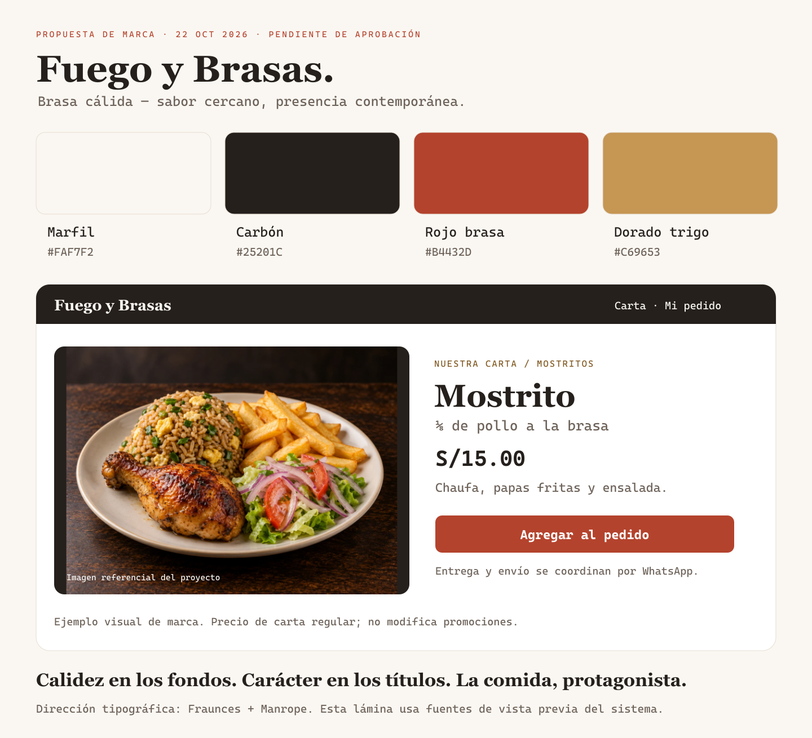

# Fuego y Brasas — Propuesta de manual de marca

**Dirección:** Brasa cálida. **Versión:** propuesta 1 · 22/10/2026. **Estado:** descartada por el propietario: no desea una dirección cálida. Se conserva únicamente como antecedente de revisión. No sustituye todavía el sistema visual canónico ni cambia los colores de producción.

## 1. Idea de marca

Una pollería cercana, con sabor a brasa y una presentación cuidada. La comida ocupa el primer plano; los fondos claros aportan calma y los detalles de carbón, rojo y dorado conectan con el material original del negocio. Se propone una identidad cálida y contemporánea, sin recargarla con llamas, texturas o varios colores de acción.

**Nombre:** Fuego y Brasas. **Frase existente:** «Sabor que une, momentos que quedan». Voz directa y amable: «Elige tu antojo», «Agregar al pedido», «Lo coordinamos por WhatsApp». Evitar superlativos no demostrados, urgencia falsa y afirmaciones de venta confirmada por abrir un chat.

## 2. Paleta propuesta

| Color | HEX | Función |
| --- | --- | --- |
| Marfil | `#FAF7F2` | Fondo principal, más neutro que el crema actual. |
| Carbón | `#25201C` | Texto, encabezados y bloques de marca. |
| Rojo brasa | `#B4432D` | Botón principal y enlaces; más cálido que el rojo actual. |
| Dorado trigo | `#C69653` | Acento discreto, líneas y detalles sobre carbón. |
| Blanco | `#FFFFFF` | Superficies de productos y formularios. |

Apoyo: texto secundario `#6D6259`; hover del rojo `#913321`; dorado para texto sobre claro `#805820`; borde decorativo `#E6DDD2`; borde de control `#8A7868`. Estados: éxito `#276346`, error `#A72F24`, información `#315D72`, siempre con texto o icono y solo cuando hay un estado real.

Distribución orientativa de superficies: 70 % marfil/blanco, 20 % carbón y 10 % acentos. No es una regla para recolorear fotografías. En un bloque, usar una acción principal roja; el dorado no compite como otro botón principal. Las fotos aportan la variedad de color.

### Legibilidad comprobada

Ratios sRGB calculados sobre colores sólidos; no equivalen a certificación de pantallas.

| Combinación | Contraste |
| --- | --- |
| Carbón / marfil | 15,09:1 |
| Texto secundario / marfil | 5,55:1 |
| Blanco / rojo brasa | 5,55:1 |
| Dorado oscuro / marfil | 5,89:1 |
| Borde de control / blanco | 4,23:1 |
| Dorado trigo / carbón | 6,06:1 |

Reservar dorado trigo sobre marfil para decoración; no usarlo en texto normal. Foco visible con contorno de 2 px, desplazado 2 px; sobre fondos oscuros usar blanco. Revisar estados reales con transparencias y fotografía al implementar.

## 3. Tipografía

Conservar **Fraunces 600–700** para marca y títulos breves y **Manrope 400–700** para productos, precios, botones y lectura. Ambas ya existen localmente con sus licencias: no añadir descargas externas ni otra familia. La lámina de aprobación usa fuentes del sistema como aproximación visual, identificada al pie; la aplicación conserva las fuentes reales.

Escala propuesta, compatible con el sistema vigente: títulos 32/38 px en móvil y 48/56 en escritorio; secciones 24/30 y 32/40; productos 18/26; texto y controles 16/24; apoyo 14/20. Precios con cifras tabulares, soles y dos decimales. No usar manuscritas para precios o instrucciones ni todo el contenido en mayúsculas.

## 4. Logotipo y recursos

Conservar el sello circular con llama/leños del negocio. No redibujarlo, inventar una versión ni recolorear el original sin autorización específica. La propuesta usa el nombre como firma tipográfica de apoyo, no presenta un logotipo nuevo. Usar el original en buena resolución cuando esté disponible, con margen libre mínimo de un cuarto del diámetro y sin deformar.

Sobre fondos oscuros o fotos, colocar una superficie sólida de apoyo si el recurso no tiene una variante aprobada legible. El nombre debe poder leerse sin depender de las letras pequeñas del sello.

## 5. Fotografía y dirección de arte

- Comida cálida y natural, porción completa, acompañamientos visibles y fondo sencillo.
- Fotos amplias, con proporción 4:3 y espacio reservado; conservar el plato completo al encuadrar.
- Usar primero fotos propias. Los recursos generados existentes llevan «Imagen referencial»; no son prueba de la porción ni fotos del local.
- No copiar fotos, logos o textos comerciales de competidores; no usar afiches como tarjetas ni precios incrustados en imágenes.
- Evitar saturación excesiva, fuego artificial, humo sobre los textos y fondos con madera detrás de controles.

## 6. Aplicación en la web

**Carta:** encabezado compacto, categorías fáciles de recorrer, foto protagonista, nombre y porción, contenido, precio y acción. Agregar directamente los platos sin opciones obligatorias; abrir detalle cuando haya que elegir una opción. Sin popularidad, descuentos o porciones inventadas.

**Detalle:** foto amplia junto a nombre, porción y precio; inclusiones legibles; cantidad, opciones reales e indicaciones opcionales. Una acción principal clara. En móvil, la imagen precede al contenido y los controles mantienen objetivos de al menos 48 × 48 px.

**Pedido:** platos y cantidades, revisión de precio y mensaje de WhatsApp. Sin selector de modalidad, dirección, zona ni cálculo de envío. El local coordina entrega y costo de envío por WhatsApp. El importe mostrado corresponde a productos, no promete un total final con envío.

**Componentes:** tarjetas 12 px, campos 8 px y botones 10 px; espacios sobre escala 4/8 px; ancho máximo 1200 px. Transiciones 150–220 ms y respeto a movimiento reducido. Iconos SVG de una familia, sin emoji estructural ni animaciones decorativas continuas.

**Personal y fidelización:** misma identidad, presentación sobria, estados explícitos y resultados sin depender del color. Un cambio de paleta no modifica diez sellos, premios, permisos, precios o reglas de compra.

## 7. Referentes y adaptación

Se revisaron los sitios oficiales de [Pardos](https://www.pardoschicken.pe/), [Don Belisario](https://www.donbelisario.com.pe/menu), [Tori](https://www.tori.pe/) y [Nando’s](https://www.nandos.co.uk/food/menu/). Son referentes conocidos, no una clasificación demostrada de «los mejores».

Pardos y Nando’s muestran navegación por categorías; Don Belisario detalla combinaciones, inclusiones y precios; Tori pone el producto y el acceso a pedir en primer plano. Se aprovecha esa jerarquía y se adapta al cierre por WhatsApp. Sus formularios de entrega, cuentas o pagos no se trasladan automáticamente a este producto.

UI/UX Pro Max aportó el perfil Restaurant/Food Service (rojo cálido y acento dorado), guías de etiquetas/feedback y uso de imágenes optimizadas. Esta propuesta ajusta los colores genéricos a Fuego y Brasas y conserva sus fuentes. La guía instalada de Next.js prevalece: se usa `preload` cuando corresponde, no el `priority` de una recomendación anterior.

## 8. Qué se solicita aprobar

La dirección **Brasa cálida**, los cinco colores principales y sus usos; conservación de Fraunces/Manrope; fotografía natural y composición limpia. El sello original se conserva. La lámina es una propuesta de aplicación, no una pantalla ya desplegada.

Con aprobación: actualizar la fuente canónica `.agents/brand/sistema-visual.md` y los tokens Tailwind, aplicar la paleta a componentes compartidos y revisar contraste/estados. Hasta entonces, la web conserva la paleta vigente y esta carpeta es material de revisión.

Archivos de apoyo: [lámina PNG](propuesta-brasa-calida.png), [original SVG](propuesta-brasa-calida.svg) y [datos de propuesta/contraste](propuesta-brasa-calida.json). Ninguno actúa como configuración productiva.
